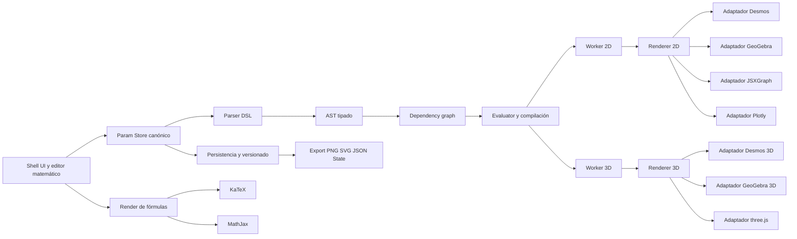
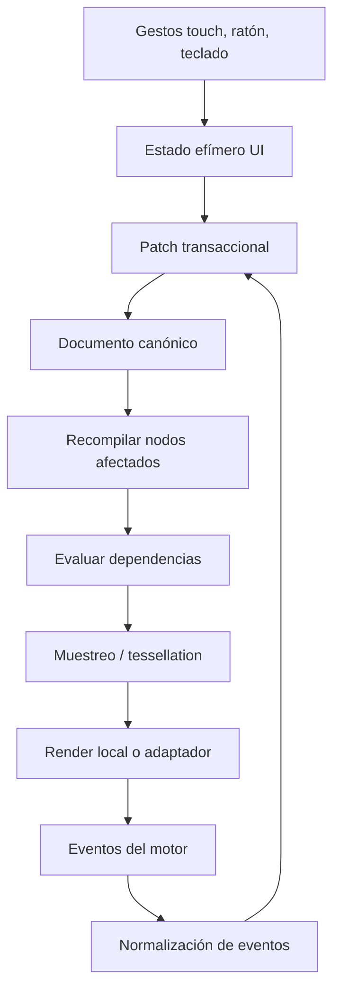
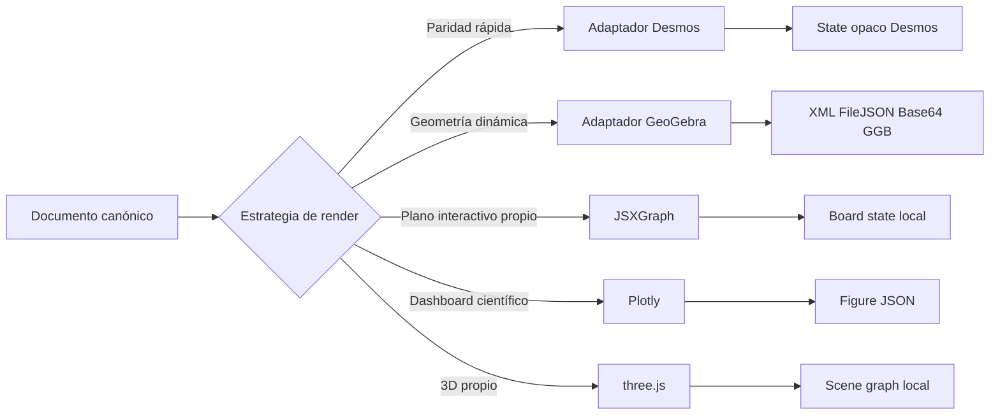

# Diseño e implementación de una lógica paramétrica para acercar una aplicación propia a Desmos y GeoGebra

## Resumen ejecutivo

La vía más robusta para cerrar el gap entre una aplicación propia y una calculadora gráfica tipo Desmos o GeoGebra no es elegir un único motor, sino diseñar un **núcleo paramétrico propio** con tres capas separadas: **modelo canónico de expresiones y parámetros**, **motor de evaluación y muestreo**, y **adaptadores de render o integración**. Esa separación permite conectar opcionalmente con Desmos o GeoGebra cuando interese acelerar la paridad funcional, y usar renderizadores locales como JSXGraph, Plotly o three.js cuando interese control total, ejecución offline, licencias más simples o una UX muy personalizada. La necesidad de esta separación se ve en que Desmos serializa el estado como un objeto opaco que recomienda no manipular directamente, mientras que GeoGebra expone varios formatos más editables como XML, JSON de fichero y Base64 de `.ggb`; además, Plotly trabaja con un modelo declarativo JSON, y three.js o p5.js exponen APIs imperativas de escena o canvas. citeturn5view1turn6view4turn6view0turn28search0turn28search3turn18view3turn18view2

Si el objetivo inmediato es un **prototipo rápido con máxima paridad percibida**, la opción más rápida es integrar **Desmos API** o **GeoGebra Apps API**: ambas permiten embedding en web, estado persistente, actualización programática y eventos; Desmos además documenta API 3D y `observeEvent('change')`, y GeoGebra ofrece `evalCommand`, listeners de add/remove/update, animación automática y carga/guardado en XML/JSON/Base64. Si el objetivo prioritario es un **producto comercial con stack OSS controlable**, la recomendación cambia: dejar Desmos y GeoGebra como integraciones opcionales, y construir el core sobre un DSL propio, un parser/evaluator aislado y render local con **JSXGraph o Plotly para 2D**, **three.js para 3D**, y **KaTeX o MathJax para tipografía matemática**. Esa estrategia reduce el acoplamiento contractual y técnico con APIs externas y evita que el “estado nativo” de un tercero se convierta en la fuente de verdad del producto. citeturn5view0turn16view3turn5view2turn5view3turn6view3turn36view0turn36view3turn14view0turn18view3turn11view6turn11view7

## Inventario comparativo de APIs y proyectos OSS relevantes

El conjunto más útil para este problema no es homogéneo: **Desmos y GeoGebra** son motores matemáticos completos con UX madura; **JSXGraph, Plotly y three.js** son librerías de visualización o geometría; **p5.js** sirve mejor para interacción y animación personalizada que para álgebra simbólica; **KaTeX y MathJax** resuelven la presentación matemática, no el graficado. Esto importa porque el gap real no es solo “dibujar curvas”, sino también **semántica de expresiones, dependencia entre parámetros, persistencia, interacción y exportación**. citeturn16view2turn6view2turn14view5turn14view0turn18view3turn14view3turn11view6turn11view7

| Proyecto | Licencia o términos | Capacidades 2D y 3D | Interactividad | Integración práctica | Estado de mantenimiento | Uso recomendado |
| --- | --- | --- | --- | --- | --- | --- |
| **Desmos API** | **No OSS**; API JavaScript con `apiKey` y términos específicos, con vías gratuitas y comerciales documentadas. citeturn5view0turn10search0turn10search4 | Gráfica 2D completa y API 3D separada; expresiones en LaTeX; soporte de implícitas, paramétricas, polar, sliders, tablas y screenshots. citeturn16view2turn35view0turn17view3turn5view2turn5view1 | Muy alta: eventos de cambio, expresiones auxiliares observables, viewport observable, sliders y animación. citeturn16view3turn16view4turn17view4 | Muy sencilla: `script` + constructor `GraphingCalculator`. citeturn5view0 | Activo; changelog oficial con cambios y fixes en 2026. citeturn33search0 | **La ruta más rápida** a una UX “tipo Desmos”. |
| **GeoGebra Apps API** | Código fuente bajo **EUPL v1.2**, pero el software/materiales de GeoGebra se distribuyen libremente para uso no comercial y el uso comercial requiere licencia especial. citeturn11view3 | `appName` soporta `graphing`, `geometry`, `3d`, `classic`, etc.; además expone comandos, CAS, XML, FileJSON y Base64 `.ggb`. citeturn5view5turn6view2turn6view4turn8search0turn8search6 | Muy alta: listeners add/remove/update, animación, control de sistema de coordenadas, repintado y visibilidad. citeturn6view3turn36view0turn36view3 | Sencilla: `deployggb.js` + `GGBApplet`, con opción self-hosted y también módulo ES6. citeturn5view4turn6view0 | Oficial y activo, con documentación, bundle descargable y apps vigentes. citeturn5view4turn9search5turn9search6 | Muy fuerte si necesitas **geometría dinámica + álgebra + 3D**. |
| **JSXGraph** | La documentación pública del proyecto indica licencia **LGPL o MIT**; GitHub identifica LGPL-3.0 y referencia un fichero MIT adicional. citeturn0search2turn14view5 | Fuerte en geometría interactiva, plotting y charting 2D; existen demos 3D y releases recientes mejorando 3D. citeturn14view5turn21search1turn21search2 | Soporta multitouch y manipulación directa en navegador. citeturn14view5 | Ligera y fácil de embeber; sin dependencias. citeturn14view5 | Activo; release 1.11.1 en noviembre de 2025. citeturn21search2 | Excelente para **plano cartesiano, geometría y controles directos**. |
| **Plotly.js** | **MIT**; libre y open source. citeturn14view1turn32search14 | Más de 40 tipos de gráfico; incluye 3D, superficies, volumen, mapas SVG y charts científicos. citeturn14view0turn22search0turn22search15 | Muy alta vía eventos (`plotly_click`, `plotly_hover`, `plotly_relayout`), sliders y animaciones; persiste zoom/pan con `uirevision`. citeturn26search0turn32search2turn32search6turn32search8 | Muy buena para apps web: `data`, `layout`, `config`, `Plotly.react`, export estático y uso offline. citeturn28search0turn28search1turn32search3turn32search14 | Muy activo; release 3.6.0 en junio de 2026. citeturn13search0 | Ideal para **visualización declarativa y cuadros 2D/3D**. |
| **three.js** | **MIT**. citeturn18view3 | Librería 3D generalista; renderers WebGL y WebGPU en builds actuales, con addons SVG/CSS3D. citeturn11view4turn18view3 | Muy alta, pero a más bajo nivel: `OrbitControls` documenta gestos táctiles de uno y dos dedos. citeturn27search0 | Media: requiere construir escena, cámara, materiales y pipeline, pero ofrece control total. citeturn11view4turn27search1 | Muy activo; r184 en abril de 2026. citeturn12search0turn18view3 | La mejor base para **superficies, mallas, nubes de puntos y render 3D propio**. |
| **p5.js** | **LGPL-2.1**. citeturn18view2 | 2D y `WEBGL`; documentación y ejemplos cubren render 3D, shaders y optimización en móvil. citeturn20search0turn20search7turn20search19 | Alta para sketches interactivos, sensores y animaciones. citeturn20search13turn14view3 | Muy simple para prototipos creativos. citeturn11view5turn14view3 | Activo, pero el sitio indica que no añadirá nuevas features salvo las que aumenten el acceso. citeturn11view5turn18view2 | Bueno para **UX experimental y animación**, no como motor matemático principal. |
| **KaTeX** | **MIT**. citeturn18view0 | No grafica; renderiza TeX/LaTeX muy rápido, sin dependencias, con SSR. citeturn11view6turn18view0 | Baja en el sentido gráfico; alta como tipografía matemática en tiempo real. citeturn11view6 | Muy fácil de integrar en frontend y backend. citeturn11view6turn18view0 | Muy activo; 0.17.0 en mayo de 2026. citeturn12search2turn12search10 | Primera opción para **render de fórmulas en UI de alto rendimiento**. |
| **MathJax** | **Apache-2.0**. citeturn18view1 | No grafica; soporta LaTeX, MathML y AsciiMath, con foco fuerte en accesibilidad y API de integración. citeturn11view7 | Baja en gráfico, alta en accesibilidad matemática. citeturn11view7 | Fácil, aunque más pesada que KaTeX. citeturn11view7 | Activo; MathJax v4.1.2 marcada como latest en mayo de 2026. citeturn19search0turn19search1 | Elegible cuando la prioridad es **notación amplia y accesibilidad**. |

La shortlist práctica queda así: **Desmos o GeoGebra** si la prioridad es “paridad rápida”; **three.js + JSXGraph/Plotly + KaTeX/MathJax** si la prioridad es control, modularidad y licencias más predecibles; **Plotly** cuando parte del producto es más “scientific dashboard” que “calculadora”; **JSXGraph** cuando la interacción geométrica directa es central. citeturn5view0turn5view3turn14view5turn14view0turn18view3turn11view6turn11view7

## Arquitectura modular y paramétrica

La decisión arquitectónica principal es que la **fuente de verdad** no debe ser ni el estado de Desmos ni el de GeoGebra. Desmos advierte que sus states son valores opacos y que manipularlos directamente puede producir estados no cargables; GeoGebra, en cambio, sí expone XML, FileJSON, Base64 y `.ggb` como formatos útiles de construcción. Por eso, lo correcto es almacenar un **documento canónico propio** y tratar los formatos de terceros como **sidecars** o snapshots adaptados. citeturn5view1turn6view4turn6view0



Esta arquitectura permite intercambiar renderers sin cambiar el lenguaje de usuario. También hace posible usar **workers** para evaluación y muestreo sin bloquear la UI, usar **OffscreenCanvas** cuando convenga para render fuera del hilo principal y reservar **WebAssembly** para kernels numéricos o geométricos intensivos. MDN documenta que Web Workers ejecutan scripts en segundo plano sin bloquear la interfaz, que OffscreenCanvas desacopla canvas y DOM y puede renderizar desde un worker, y que WebAssembly ofrece un formato binario compacto con rendimiento cercano a nativo en un entorno sandboxed. citeturn23search0turn23search1turn23search2turn23search10



El flujo recomendado es **unidireccional con patches**, no sincronización bidireccional “a mano”. La razón es operativa: Desmos expone un evento `change` pensado para persistencia sin polling; GeoGebra ofrece listeners de add/remove/update; Plotly emite eventos de click, hover y relayout; y `Plotly.react` permite preservar cambios del usuario con `uirevision`. Todos esos eventos deben normalizarse a un mismo formato interno. citeturn16view3turn6view3turn26search0turn32search6turn32search8



El trade-off es claro. **API externa** significa menos trabajo inicial, mejor paridad y menos riesgo de “reinventar” semántica matemática básica; a cambio, introduce dependencia de términos, licencias y formatos nativos. **Motor propio** significa más esfuerzo en parser, evaluator, muestreo implícito y 3D, pero ofrece mejor control de licencias, de seguridad y de UX. Además, Desmos documenta opciones de self-hosting y señala que su API no requiere PII ni data passback, mientras que GeoGebra ofrece bundle self-hosted; por tanto, incluso una estrategia híbrida puede minimizar exposición de datos si se negocia o despliega correctamente. citeturn10search1turn10search5turn5view4

## Especificación técnica de la lógica paramétrica

La “lógica paramétrica” debería definirse como un **subsistema declarativo** que modela: **parámetros**, **expresiones dependientes**, **dominios**, **animaciones**, **bindings de UI**, **políticas de evaluación** y **destinos de render**. El gap con Desmos y GeoGebra se cierra cuando ese subsistema soporta al menos estos objetivos funcionales: **ecuaciones explícitas**, **implícitas**, **paramétricas**, **polares**, **tablas/listas**, **sliders y animación en tiempo real**, **pan/zoom/drag táctil**, y **exportación/importación** a un formato canónico propio y a sidecars de terceros. Desmos documenta LaTeX, implícitas, paramétricas, polar, sliders y helper expressions; GeoGebra documenta comandos, LaTeX básico, animación, listeners y exportación en varios formatos. citeturn16view2turn35view0turn16view4turn6view2turn36view0turn6view4

Como requisitos no funcionales, el diseño debería exigir **actualización incremental**, **aislamiento de hilos**, **modularidad por adaptadores**, **licencias compatibles con un core OSS comercializable**, y **seguridad por allowlist y sandboxing**. Desde la plataforma web, los elementos más relevantes son Workers, OffscreenCanvas, WebAssembly, CSP e iframes sandboxed; desde el lado servidor, conviene recordar que `node:vm` **no es** un mecanismo de seguridad y no debe usarse para ejecutar código no confiable. citeturn23search0turn23search1turn23search2turn23search7turn24search2turn38search1

Una especificación razonable del DSL puede ser pequeña, explícita y tipada. La sintaxis no tiene que copiar exactamente a Desmos o GeoGebra; basta con que pueda **importar** desde LaTeX o comandos y transformarlos a nodos canónicos. Un núcleo mínimo podría ser este:

```ebnf
statement      := assignment | relation | renderable
assignment     := IDENT "=" expr
relation       := expr ( "=" | "<" | "<=" | ">" | ">=" ) expr
renderable     := expr
expr           := sum
sum            := product (("+" | "-") product)*
product        := power (("*" | "/") power)*
power          := unary ("^" unary)*
unary          := ("+" | "-") unary | primary
primary        := NUMBER | IDENT | call | tuple | list | "(" expr ")"
call           := IDENT "(" args? ")"
args           := expr ("," expr)*
tuple          := "(" expr "," expr ("," expr)? ")"
list           := "[" expr ("," expr)* "]"
```

Encima de esa gramática, conviene definir unos pocos **constructos semánticos**: `implicit(F(x,y)=0)`, `param([x(t),y(t)], tmin, tmax)`, `surface(z=f(x,y))`, `paramSurface([x(u,v),y(u,v),z(u,v)], umin, umax, vmin, vmax)`, `points([...])`, `table(x[],y[])`, `slider(a,min,max,step)`, `animate(a,speed,loop)`. Esto simplifica las traducciones hacia Desmos (`latex`, `parametricDomain`, `sliderBounds`, `playing`) y hacia GeoGebra (`evalCommand`, `setValue`, `setAnimating`, `startAnimation`). citeturn35view0turn36view0turn6view2

Para el parser y evaluator hay dos rutas sensatas. La primera es **motor propio** con parser Pratt o generador PEG/Chevrotain y un evaluator por nodos. La segunda es usar un parser existente como **math.js** como referencia o base parcial, ya que documenta `parse`, `compile`, `evaluate`, árboles de expresión y un parser con scope en memoria. Sin embargo, si se usa math.js con input arbitrario, hay que tratarlo con mucha cautela: la propia documentación advierte riesgos de seguridad y estabilidad, y en 2026 el proyecto publicó una advisory alta que afecta al parser de expresiones y se corrige en `v15.2.0`. En otras palabras: si se adopta, debe ser con **pinning estricto**, allowlist de funciones, aislamiento adicional y sin exponerlo como “sandbox seguro”. citeturn29search1turn29search16turn29search20turn30search0turn31search0turn31search2

La serialización debería separar el **estado canónico** de los **estados de adaptador**. Un ejemplo de JSON práctico sería este:

```json
{
  "version": "1.0",
  "viewport": {
    "type": "cartesian2d",
    "xMin": -10,
    "xMax": 10,
    "yMin": -10,
    "yMax": 10
  },
  "parameters": {
    "a": { "type": "slider", "value": 2, "min": 0, "max": 10, "step": 0.1, "playing": false },
    "t": { "type": "clock", "value": 0, "speed": 1.0, "loop": true }
  },
  "expressions": [
    {
      "id": "f1",
      "sourceFormat": "canonical",
      "source": "y = a*sin(x)",
      "kind": "explicit2d",
      "style": { "stroke": "#1f77b4", "lineWidth": 2 }
    },
    {
      "id": "c1",
      "sourceFormat": "canonical",
      "source": "x^2 + y^2 = 9",
      "kind": "implicit2d",
      "sampling": { "grid": 256, "algorithm": "marching-squares" }
    },
    {
      "id": "p1",
      "sourceFormat": "canonical",
      "source": "[cos(t), sin(t), t/4]",
      "kind": "parametric3d",
      "domain": { "tMin": 0, "tMax": 12.56637 }
    }
  ],
  "uiBindings": {
    "selectedExpressionId": "f1",
    "showGrid": true,
    "theme": "light"
  },
  "adapterStates": {
    "desmos": { "opaqueState": null },
    "geogebra": { "fileJson": null, "base64": null }
  }
}
```

Ese diseño evita que el documento se vuelva rehén de un solo motor. El motivo es técnico: Desmos ofrece `getState()` pero pide tratarlo como opaco; GeoGebra sí devuelve construcciones en XML, FileJSON o Base64; Plotly usa figuras JSON; y el estado de three.js o JSXGraph suele ser más natural como estado de escena o board generado desde el modelo canónico. citeturn5view1turn6view4turn28search0turn14view5turn18view3

La sincronización entre UI y motor debería ser **reactiva e incremental**: parsear una vez, construir grafo de dependencias, recompilar solo nodos afectados, y reenviar patches a renderers. En Desmos eso encaja con `setExpression`/`setExpressions`, `getExpressions`, helper expressions y `observeEvent('change')`; en GeoGebra con `evalCommand`, `setValue`, listeners y `setRepaintingActive(false)` para batch updates; en Plotly con `Plotly.react`, eventos y `uirevision` para no perder la interacción del usuario en cada re-render. citeturn17view0turn17view2turn16view4turn16view3turn6view2turn6view3turn36view3turn28search0turn32search6turn32search8

La estrategia de pruebas debería incluir **golden tests de parser**, **tests diferenciales por muestras** frente a Desmos y GeoGebra en el subconjunto común, **tests visuales por screenshot**, y **presupuestos de rendimiento**. Desmos documenta screenshot PNG y changelog con mejoras periódicas de rendimiento; Plotly soporta exportación estática; three.js recomienda `setAnimationLoop()` para compatibilidad del loop de render. Es decir: hay soporte suficiente para automatizar regresiones de render en varios niveles. citeturn5view1turn33search0turn32search3turn27search1

## Integración opcional con Desmos, GeoGebra y librerías locales

La recomendación operativa es implementar cada integración como un **adapter package** detrás de una interfaz estable del tipo `init`, `mount`, `applyPatch`, `exportState`, `importState`, `subscribe`, `dispose`. En la documentación pública, la superficie de Desmos es una **API JavaScript embebida por script con `apiKey`**; la de GeoGebra es **embedding con `deployggb.js`**, `GGBApplet`, parámetros como `appName`, `material_id` o `filename`, y una Apps API posterior. En Plotly, three.js, p5.js y JSXGraph la integración es local, sin servicio externo, y Plotly documenta explícitamente el uso offline salvo el caso particular de ciertos mapas con tiles externos. citeturn5view0turn5view4turn5view5turn32search14

| Opción | Entrada documentada | Autenticación | Guardado y carga | Eventos o sincronización | Límites y fallback |
| --- | --- | --- | --- | --- | --- |
| **Desmos** | `calculator.js?apiKey=...`, `Desmos.GraphingCalculator(...)`; API 3D documentada aparte. citeturn5view0turn5view2 | `apiKey`; además existen términos comerciales y opciones de self-hosting/partner. citeturn10search0turn10search4turn10search1 | `getState/setState`, `getExpressions/setExpressions`, screenshot PNG; el estado debe tratarse como opaco. citeturn5view1turn17view0turn17view2 | `observeEvent('change')`, `expressionAnalysis`, `graphpaperBounds`, helper expressions. citeturn16view3turn16view2turn17view4turn16view4 | Excelente paridad, pero **no OSS** y fuerte acoplamiento al formato nativo; fallback: traducir desde el documento canónico a renderer local. citeturn10search0turn5view1 |
| **GeoGebra** | `deployggb.js`, `new GGBApplet(...)`, `appName: graphing|geometry|3d`, `material_id` o `filename`; opción self-hosted. citeturn5view4turn5view5 | En la ruta pública de embedding no aparece token para el flujo básico; el control comercial va por licencia, no por OAuth/API key documentados. citeturn5view4turn11view3 | `getXML`, `getFileJSON`, `getBase64`, `setBase64`; `.ggb` es ZIP con XML e imágenes. citeturn6view4turn6view0turn8search0turn8search6 | Listeners add/remove/update, animación, coord system, batch repainting. citeturn6view3turn36view0turn36view3 | Muy potente, pero con más matices de licencia; fallback: usarlo como plugin opcional y no como base del core. citeturn11view3 |
| **JSXGraph** | Board local JavaScript. citeturn14view5 | No requiere autenticación. citeturn14view5 | Estado normalmente propio de aplicación; no hay un “graph state” opaco equivalente a Desmos. citeturn14view5 | Multi-touch e interacción directa. citeturn14view5 | Muy bueno en 2D y geometría; 3D existe, pero three.js sigue siendo mejor base para 3D intensivo. citeturn21search1turn18view3 |
| **Plotly** | `Plotly.newPlot`, `Plotly.react`, `Plotly.animate`; modelo `data/layout/config`. citeturn28search0turn32search2 | Sin auth para el uso base; offline soportado salvo casos de tiles externos. citeturn32search14 | Figura JSON y exportación estática. citeturn28search3turn32search3 | Eventos click/hover/zoom/relayout; `uirevision`. citeturn26search0turn32search6turn32search8 | Muy útil como renderer declarativo, menos natural para sintaxis matemática tipo calculadora. citeturn14view0turn28search0 |
| **three.js** | Imports ESM y escena local; controls y renderer propios. citeturn11view4turn27search1 | No requiere autenticación. citeturn18view3 | Estado de escena propio. citeturn18view3 | Touch con `OrbitControls`; animación con `setAnimationLoop`. citeturn27search0turn27search1 | Mejor opción para 3D propio; requiere construir semántica matemática fuera de three.js. citeturn18view3 |

Ejemplo mínimo de integración con **Desmos** desde un adaptador propio:

```html
<div id="desmos-host"></div>
<script src="https://www.desmos.com/api/v1.12/calculator.js?apiKey=TU_API_KEY"></script>
<script>
  const el = document.getElementById('desmos-host');
  const calc = Desmos.GraphingCalculator(el, { expressions: true, keypad: true });

  calc.setExpressions([
    { id: 'a', latex: 'a=2', sliderBounds: { min: '0', max: '10', step: '0.1' } },
    { id: 'f', latex: 'y=a\\sin(x)' },
    { id: 'c', latex: 'x^2+y^2=9' }
  ]);

  calc.observeEvent('change', () => {
    syncOut({
      vendor: 'desmos',
      state: calc.getState(),
      expressions: calc.getExpressions()
    });
  });
</script>
```

Este ejemplo sigue exactamente la superficie documentada: carga por `apiKey`, uso de `GraphingCalculator`, `setExpressions`, `getState`, `getExpressions` y `observeEvent('change')`. En producción conviene tratar `state` como snapshot opaco y seguir usando el documento canónico como fuente de verdad. citeturn5view0turn17view0turn17view2turn16view3turn5view1

Ejemplo mínimo de integración con **GeoGebra**:

```html
<script src="https://www.geogebra.org/apps/deployggb.js"></script>
<div id="ggb-host"></div>
<script>
  const applet = new GGBApplet({
    appName: 'graphing',
    width: 800,
    height: 500,
    appletOnLoad(api) {
      api.evalCommand('a = 2');
      api.evalCommand('f(x) = a * sin(x)');
      api.evalCommand('c: x^2 + y^2 = 9');

      api.registerUpdateListener((name) => {
        syncOut({ vendor: 'geogebra', changedObject: name, fileJson: api.getFileJSON() });
      });
    }
  }, true);

  window.addEventListener('load', () => applet.inject('ggb-host'));
</script>
```

La documentación pública de GeoGebra cubre `deployggb.js`, `GGBApplet`, `appletOnLoad`, `evalCommand`, listeners y exportación de construcción con `getFileJSON`, así que este patrón es el más natural para un adaptador web moderno. GeoGebra también documenta batching con `setRepaintingActive(false)` si vas a aplicar muchos patches de golpe. citeturn5view4turn6view2turn6view3turn6view4turn36view3

Ejemplo mínimo de renderer local con **JSXGraph**:

```html
<div id="jxgbox" style="width:800px;height:500px"></div>
<script>
  const board = JXG.JSXGraph.initBoard('jxgbox', {
    boundingbox: [-10, 10, 10, -10],
    axis: true
  });

  const a = board.create('slider', [[-8, 8], [-3, 8], [0, 2, 10]]);
  board.create('functiongraph', [x => a.Value() * Math.sin(x)]);
</script>
```

JSXGraph encaja bien para un renderer 2D local porque es ligero, no depende de otras librerías, soporta multi-touch y está muy orientado a geometría y plotting interactivo. También dispone de un banco amplio de ejemplos y demos 3D, lo que facilita partir de patrones existentes. citeturn14view5turn21search0turn21search1

Ejemplo mínimo de renderer local con **three.js** para un pipeline 3D propio:

```js
import * as THREE from 'three';
import { OrbitControls } from 'three/addons/controls/OrbitControls.js';

const scene = new THREE.Scene();
const camera = new THREE.PerspectiveCamera(45, width / height, 0.1, 1000);
camera.position.set(8, 8, 8);

const renderer = new THREE.WebGLRenderer({ antialias: true });
renderer.setSize(width, height);
mount.appendChild(renderer.domElement);

const controls = new OrbitControls(camera, renderer.domElement);
controls.target.set(0, 0, 0);

renderer.setAnimationLoop(() => {
  controls.update();
  renderer.render(scene, camera);
});
```

En three.js el trabajo matemático no viene “hecho”: hay que generar vértices, índices, mallas o nubes de puntos a partir del evaluator propio. Pero a cambio se obtiene control fino del render 3D, del loop de animación y de los gestos táctiles documentados por `OrbitControls`. citeturn18view3turn27search0turn27search1

Para la capa de tipografía matemática, la elección práctica es doble: **KaTeX** en las rutas calientes del editor por su render síncrono, sin dependencias y con SSR; **MathJax** cuando necesites máxima cobertura de formatos y más foco en accesibilidad matemática. Se pueden usar de forma complementaria: KaTeX en el input list y MathJax en vistas de lectura o export avanzado. citeturn11view6turn18view0turn11view7turn18view1

## Licencias OSS compatibles y estrategia de contribución

Si el producto tiene aspiración comercial, la estrategia de licencias debería ser deliberada desde el día uno. La recomendación más segura es publicar el **núcleo propio** —DSL, parser, evaluator, dependency graph y contratos de adaptador— bajo **MIT o Apache-2.0**, y mantener las integraciones externas en paquetes separados. Eso alinea bien con **three.js**, **Plotly.js** y **KaTeX** (MIT), y con **MathJax** (Apache-2.0). También hace más sencillo mantener un `NOTICE`/`THIRD_PARTY_NOTICES` claro. citeturn18view3turn14view1turn18view0turn18view1

Con **Desmos** no hay una cuestión de compatibilidad OSS, sino de **términos de API**: debe tratarse como un proveedor externo con su propia política de `apiKey`, uso comercial y, si aplica, self-hosting por acuerdo. Con **GeoGebra** la situación es más delicada: aunque el código fuente está bajo EUPL v1.2, la licencia pública de GeoGebra distingue entre uso no comercial libre y uso comercial sujeto a licencia especial; por eso, para un producto comercial, lo prudente es integrarlo como componente opcional y no basar el core o la distribución principal en sus materiales o builds sin aclarar ese marco jurídico. citeturn10search0turn10search4turn10search1turn11view3

Un enfoque equilibrado sería este: **core MIT o Apache-2.0**, **adaptadores MIT/Apache-2.0 cuando dependan de librerías permisivas**, y **adaptadores marcados como opcionales** cuando conecten con componentes de términos especiales o con copyleft que quieras aislar. En el caso de GeoGebra, la propia EUPL documenta compatibilidades salientes con LGPL, MPL, GPL y AGPL, pero eso no elimina la obligación de respetar las condiciones específicas de uso de GeoGebra como software/material. citeturn34search1turn34search2turn11view3

La estrategia de contribución también debería reflejar esa modularidad: un repositorio para el **core paramétrico**, paquetes separados para `adapter-desmos`, `adapter-geogebra`, `renderer-jsxgraph`, `renderer-plotly`, `renderer-three`, y una política de contribución con **DCO o CLA**, guía de estilo, `SECURITY.md`, SBOM y tests de regresión visual. Desde el punto de vista del ecosistema abierto, eso facilita aceptar contribuciones sin contaminar el core con decisiones de licenciamiento o contratos de terceros. citeturn14view1turn18view3turn31search2

## Estimación de esfuerzo, riesgos y mitigaciones

La complejidad real depende de si se busca solo “parecido visual” o **paridad funcional**. Un prototipo convincente no necesita replicar toda la semántica de Desmos o GeoGebra, pero un MVP serio sí necesita un core paramétrico, import/export, interacción robusta, pruebas diferenciales y endurecimiento de seguridad. La estimación que sigue asume un frontend web moderno, un equipo pequeño y un alcance contenido a 2D primero y 3D después.

| Entregable | Alcance principal | Roles dominantes | Esfuerzo estimado |
| --- | --- | --- | --- |
| **Prototipo funcional** | DSL mínimo, sliders, explícitas/implícitas/paramétricas 2D, renderer local, KaTeX, export JSON/PNG, un adaptador externo a elegir | 1 frontend senior, 1 ingeniero de matemáticas/gráficos, 0.5 QA | **320–420 horas** |
| **MVP técnico** | Todo lo anterior + adapter Desmos y GeoGebra, persistencia versionada, touch serio, tests visuales, 3D básico con three.js, workers, CSP/sandboxing, documentación | 1 frontend senior, 1 ingeniero de matemáticas/gráficos, 1 backend/platform parcial, 1 QA | **900–1.200 horas** |
| **MVP de producto** | Hardening móvil, accesibilidad, analítica, observabilidad, import/export multiprotocolo, packaging/licencias, telemetría y soporte | Equipo anterior + product/design parcial | **1.200–1.600 horas** |

Un posible calendario de hitos sería: **hito de arquitectura y DSL**, **hito 2D local**, **hito de adapters externos**, **hito 3D y performance**, y **hito de seguridad/licencias/release**. El orden importa: si no congelas pronto el modelo canónico, cada integración posterior multiplicará el coste.

| Riesgo | Impacto | Mitigación recomendada |
| --- | --- | --- |
| **Dependencia contractual o de plataforma** con Desmos o GeoGebra | Puede bloquear uso comercial o cambios de pricing/terms | Mantener **documento canónico propio** y adapters opcionales; no usar estados de terceros como única fuente de verdad. citeturn5view1turn11view3turn10search0 |
| **Incompatibilidad de formatos** entre motores | Pérdida de fidelidad al importar o migrar | Separar `canonicalState` y `adapterStates`; conservar sidecars nativos solo para round-trip. citeturn5view1turn6view4 |
| **Riesgo de seguridad en parsers o “sandboxes” falsos** | RCE, DoS o ejecución no deseada | No usar `eval` ni `node:vm` con input no confiable; usar allowlist, límites de complejidad, workers y aislamiento de proceso si hay ejecución server-side. Si se usa math.js, fijar versión parcheada y limitar superficie. citeturn38search1turn30search0turn31search0turn31search2 |
| **Jank del hilo principal** con gráficos y muestreo pesado | UX pobre en móvil o pantallas táctiles | Parse/evaluate/sample en **Web Workers**; mover render canvas pesado a **OffscreenCanvas** cuando sea posible; reservar **Wasm** para kernels numéricos intensivos. citeturn23search0turn23search1turn23search2 |
| **Escape de sandbox al embeber contenido** | Filtración de datos o ejecución con privilegios excesivos | Usar **CSP**, orígenes separados y `iframe sandbox`; evitar la combinación `allow-scripts` + `allow-same-origin` en contenido del mismo origen. citeturn23search7turn24search2turn37view1turn37view2 |
| **Divergencia matemática entre Desmos, GeoGebra y motor propio** | Resultados distintos y bugs difíciles de explicar | Tests diferenciales por muestreo, catálogo explícito del subconjunto compatible y flags por backend. citeturn16view2turn6view2 |
| **Sobrecoste del 3D propio** | Retrasos significativos del roadmap | Limitar 3D del MVP a superficies y curvas paramétricas; dejar implícitas 3D densas para fase posterior con worker + Wasm + three.js. citeturn18view3turn27search1turn23search2 |

Las preguntas abiertas más importantes son jurídicas y de alcance. La documentación pública deja bastante claro el embedding y las APIs de Desmos y GeoGebra, pero no cubre con el mismo detalle todas las combinaciones de uso comercial, private hosting o distribución derivada; para un lanzamiento comercial, eso debe validarse jurídicamente. También queda abierta la profundidad del soporte 3D que realmente necesitas: hay una gran diferencia entre “curva paramétrica 3D” y “superficie implícita densa con manipulación táctil fluida en móvil”. citeturn10search0turn10search1turn11view3turn21search1turn18view3

En términos de decisión, la recomendación final es esta: **núcleo canónico propio + render local por defecto + adapters opcionales a Desmos y GeoGebra**. Esa combinación maximiza flexibilidad, reduce lock-in y permite escoger, por caso de uso, entre paridad rápida y control total. Para un primer prototipo, el camino más eficiente es **DSL mínimo + JSXGraph o Plotly para 2D + three.js para 3D + KaTeX para la UI matemática**, añadiendo **Desmos** como acelerador de paridad o **GeoGebra** cuando la geometría dinámica sea diferencial. citeturn14view5turn14view0turn18view3turn11view6turn5view0turn5view3