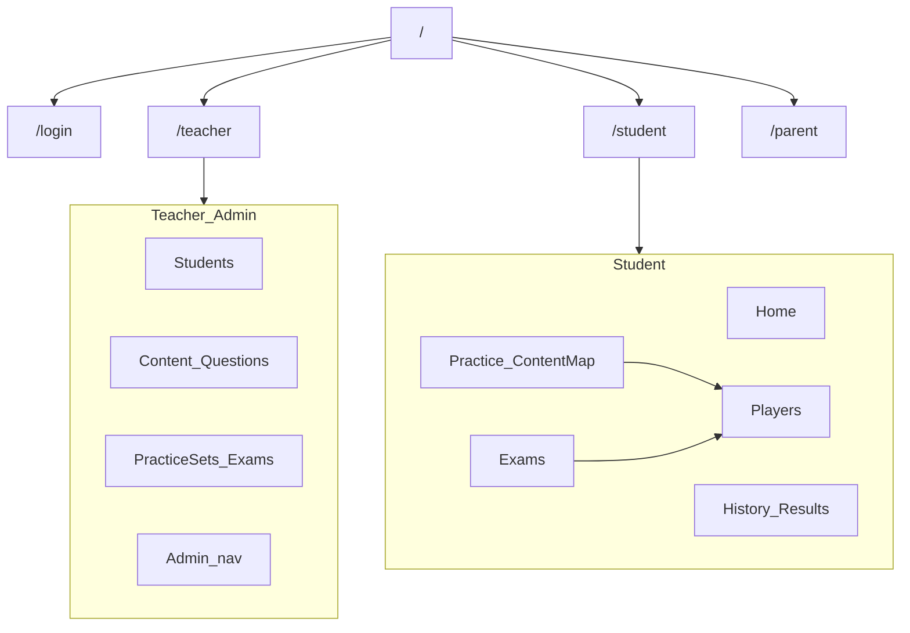
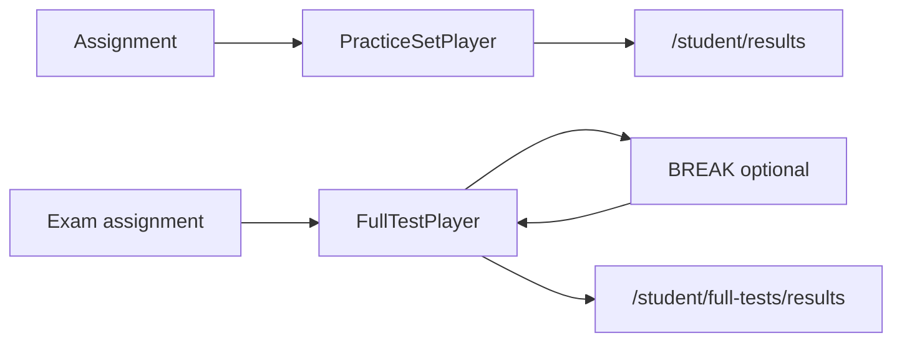

# UI System Design — Inventario de pantallas

Documento factual generado desde el código (`app/**/page.tsx`, layouts y clientes asociados).  
Incluye: arquitectura de portales, **stack por vista/componente**, navegación, elementos, conteos de opciones fijas y componentes reutilizados.

> **AS-IS.** Este doc describe el estado actual del UI.  
> **TO-BE / decisiones:** [`propuesta-reformulacion-sat.md`](../propuesta-reformulacion-sat.md).  
> **Backlog UI ordenado:** [`CONSIDERACIONES_UI.md`](CONSIDERACIONES_UI.md).  
> **Backlog de producto:** [`CONSIDERACIONES_PRODUCTO.md`](CONSIDERACIONES_PRODUCTO.md) (antes `consideraciones.md`).  
> Gaps resumidos: §8 al final.

**Alcance:** UI / layout / labels / selects fijos / empty states / stack tecnológico de render.  
**Fuera de alcance:** contratos API detallados, esquema Prisma completo, tokens visuales.

---

## 1. Arquitectura UI

### 1.1 Portales

| Portal | Route group | Chrome | Roles típicos |
|--------|-------------|--------|---------------|
| Auth | `app/(auth)` | Sin nav (passthrough) | Anónimo / activación |
| Teacher | `app/(teacher)` | `NavTeacher` | TEACHER, ADMIN |
| Student | `app/(student)` | `NavStudent` | STUDENT (+ PARENT embebido en home) |
| Parent | `app/(parent)` + `app/parent/access` | Mini-nav / standalone | PARENT |
| Admin | `app/admin/*` | `NavTeacher` (mismo shell) | ADMIN |
| Shared | `app/notifications` | Nav según rol | Todos aprobados |

El route group `(…)` **no** aparece en la URL. `/` (`app/page.tsx`) solo redirige según sesión/rol.

### 1.2 Feature flags (ocultan nav / pantallas)

Definidos en Settings (`FEATURE_SETTINGS` + API `lib/feature-flags.ts` / `GET /api/feature-flags`, 6 flags). Metadata: `owner`, `expiresAt`. **Flag ≠ auth.**

1. Student unlock requests  
2. Student self enrollment  
3. Teacher program management → `/teacher/programs`  
4. Teacher group management → Groups en nav + columnas Group  
5. Question graph visualization option → checkbox en editor Math  
6. Study Materials module → Materials en Teacher/Student  

### 1.3 Diagrama de portales

### 1.4 Stack UI baseline

Stack común del front (desde `package.json`, `app/globals.css`, layouts):

| Capa | Tecnología | Notas |
|------|------------|--------|
| Framework | Next.js 16 App Router (webpack) | `page.tsx` / layouts |
| UI lib | React 19 | Server Components + Client Components |
| Estilos | Tailwind CSS v4 (`@import "tailwindcss"`) | utilidades en JSX |
| Primitivos UI | `components/ui/*` | Radix: dialog, dropdown, tabs, tooltip, label, slot |
| Iconos | lucide-react | muy extendido |
| Math | KaTeX vía `MathContent` | CSS en globals |
| Datos SSR | Prisma + better-sqlite3 | pages/layouts server |
| Auth sesión | NextAuth v5 | gates en layouts |
| Interactividad | `"use client"` + `fetch` a `/api/*` | formularios = controlled state (casi sin RHF) |
| Deps poco usadas en vistas | react-hook-form / Zod / TanStack Table | en package; casi no aparecen en pantallas |

**Convención `**Stack:**` por vista:**

`Modo · Estilos · Iconos · UI kit · Render especial · Datos · Interacción`

Ejemplo: `RSC + Client child · Tailwind · Lucide · ui/card+badge · MathContent(KaTeX) · Prisma SSR · fetch PATCH`

#### Leyenda de abreviaturas

| Abrev. | Significado |
|--------|-------------|
| RSC | React Server Component (`page.tsx` sin `"use client"`) |
| Client | Client Component (`"use client"`) |
| Tailwind | Tailwind CSS v4 utility classes |
| Radix | Primitivos Radix vía `components/ui/*` |
| Lucide | `lucide-react` icons |
| KaTeX | Render math vía `MathContent` |
| Prisma SSR | Datos cargados en servidor con Prisma |
| fetch API | `fetch` desde cliente a `/api/*` |
| HTML table | `<table>` nativo + Tailwind (no TanStack Table) |

---

## 2. Mapa de navegación

### 2.1 Teacher — `components/nav-teacher.tsx`

**Stack:** Client · Tailwind · Lucide · Radix dropdown/tooltip · NextAuth session props · config `lib/nav-config.ts` (`resolveTeacherNav`) · flags `lib/feature-flags.ts` · fetch avatar `/api/profile/avatar`

Brand: **SAT Platform**

Fuente de ítems: `TEACHER_NAV` + `ADMIN_NAV_GROUP` en `lib/nav-config.ts` (desktop y drawer consumen `resolveTeacherNav`).

| Grupo | Ítems | Href | Condición |
|-------|-------|------|-----------|
| Students ▾ | Students | `/teacher` | siempre |
| | Student Analytics | `/teacher/analytics` | siempre |
| | Groups | `/teacher/groups` | flag Groups o ADMIN |
| | Parents | `/teacher/parents` | siempre |
| Programs | Programs | `/teacher/programs` | flag Programs |
| Content ▾ | Content Map | `/teacher/content` | siempre |
| | Materials | `/teacher/materials` | flag Materials |
| | Questions | `/teacher/questions` | siempre |
| | Subskills | `/teacher/subskills` | siempre |
| Assessments ▾ | Practice Sets | `/teacher/practice-sets` | siempre |
| | Exams | `/teacher/full-tests` | siempre |
| | Compare | `/teacher/compare` | siempre |
| Admin ▾ | Programs | `/admin/programs` | role ADMIN |
| | Groups | `/teacher/groups` | ADMIN |
| | Teachers | `/admin/teachers` | ADMIN |
| | Accounts | `/admin/users` | ADMIN |
| | Taxonomy | `/admin/taxonomy` | ADMIN |
| | AI Import | `/admin/import/ai` | ADMIN |
| | Audit Log | `/admin/logs` | ADMIN |
| | Settings | `/admin/settings` | ADMIN |

**Derecha:** `NotificationBell` · menú usuario (Change photo `jpeg|png|webp`, Change password `/auth/change-password`, Sign out) · hamburger &lt;lg.

### 2.2 Student — `components/nav-student.tsx`

**Stack:** Client · Tailwind · Lucide · Radix tooltip · NextAuth · config `resolveStudentNav` · flags · fetch avatar

Brand: **SAT Practice**

| Modo | Links | Conteo |
|------|-------|--------|
| Enrollment activo | Home, Practice Sets, Content Map, Materials*, Exams, History | **5** o **6** (*Materials) |
| Sin enrollment | Programs → `/student/program` | **1** |

Extras: banner impersonación (**Exit Student View**); banner sin enrollment; mismo menú usuario (3 acciones); mobile drawer.

### 2.3 Parent

- Portal `/parent`: “SAT Parent Portal” + link Notifications.  
- Access `/parent/access?token=`: sin chrome de portal (standalone).

### 2.4 Notifications — `/notifications`

**Stack:** RSC · Tailwind · ui/card · Prisma SSR · chrome Nav por rol

Shell: `NavTeacher` / `NavStudent` / nav parent según rol. Lista de links (título + fecha + body). Empty: `No notifications yet.`

---

## 3. Inventario por módulo

Convención por pantalla:

- **Ruta** · **Stack** · **Título** · **Layout** · **Componentes** · **Elementos** · **Opciones fijas** · **Empty**

---

### 3.1 Auth

#### `/` — Redirect
**Stack:** Next.js redirect only (sin UI)
Sin UI. Destinos: `/login`, `/auth/pending-validation`, `/teacher`, `/parent`, `/student`.

#### `/login`
**Stack:** Client · Tailwind · ui/input+button+card · RHF + Zod (`contracts/auth` loginSchema) · `FormSection` · NextAuth `signIn`
- **H1:** SAT Practice Platform · Sub: Sign in to your account  
- **Layout:** Card centrada, logo “SAT”  
- **Campos:** Email, Password (validación cliente Zod)  
- **CTAs:** Log In / Signing in… · Link Forgot your password?  
- **Error:** Invalid email or password. · field messages vía `FormMessage`

#### `/auth/forgot-password`
**Stack:** Client · Tailwind · ui/input+button+card · RHF + Zod (`forgotPasswordSchema`) · fetch `/api/auth/forgot-password`
- **H1:** Reset your password  
- **Campo:** email · **CTA:** Send Reset Link · Back to login  
- **Success:** If that email is registered…

#### `/auth/reset-password?token=`
**Stack:** Client · Tailwind · ui/input+button+card · RHF + Zod (`setPasswordSchema`) · fetch `/api/auth/reset-password`
- **H1:** Set new password  
- **Campos:** New Password, Confirm Password · **CTA:** Save Password

#### `/auth/activate?token=`
**Stack:** Client · Tailwind · ui/input+button+card · RHF + Zod (`activateSchema`) · `LoadingState`/`ErrorState` · fetch invite-info + `/api/auth/activate`
- **H1:** Welcome/Hello, {name}!  
- **Campos:** Email (disabled), Phone?, Start date, Program, Password, Confirm  
- **CTAs:** Activate Account / Create Account  
- **Estados:** Loading… · token inválido · banner parent consent pendiente

#### `/auth/parent-consent?token=`
**Stack:** Client · Tailwind · ui/button+card+input · RHF + Zod (`parentConsentSchema`) · `LoadingState`/`ErrorState` · fetch `/api/auth/parent-consent`
- **H1:** Parent Authorization  
- **Campos:** Parent account password, Confirm · **CTA:** Authorize enrollment  
- **Success:** Authorization recorded…

#### `/auth/pending-validation`
**Stack:** RSC · Tailwind · ui/card · session/props server
- **H1:** pending review / not approved · Eyebrow: Account validation  
- **Link:** Back to login

#### `/auth/change-password`
**Stack:** Client · Tailwind · ui/input+button+card · `PageShell` · RHF + Zod (`changePasswordSchema`) · fetch `/api/auth/change-password`
- **Campos:** Current, New, Confirm · **CTA:** Save Password · Success: Password updated.

---

### 3.2 Admin

Admin usa layout `app/admin/layout.tsx` → `NavTeacher`.

#### `/admin/logs?cat=`
**Stack:** RSC + Client child (`AuditPayload`) · Tailwind · ui/card+badge · HTML table · Prisma SSR
- **H1:** Audit Log  
- **Tabs (9):** All, Auth, Users, Attempts, Content, Import, Programs, Errors, Other  
- **Tabla:** When | Who | Event | Target / payload  
- **Badges:** success / failure / info · `new`  
- **Componentes:** `card`, `AuditPayload` (expand/copy)  
- **Empty:** No events recorded yet.

#### `/admin/teachers?q=`
**Stack:** RSC + Client (`AdminTeachersTable` / `TeacherToggle`) · Tailwind · Lucide · `PageShell`/`FilterBar`/`DataTable` · Prisma SSR · fetch toggle
- **H1:** Teachers · Search + Search button  
- **Tabla (`DataTable` priority):** Teacher | Programs | Status | Action  
- **Badges:** Enabled / Disabled  
- **CTA fila:** Enable / Disable (`TeacherToggle`)
- **Empty:** EmptyState via DataTable

#### `/admin/users?q=`
**Stack:** RSC + Client (`AdminUsersTable` / `UserValidationActions`) · Tailwind · `PageShell`/`FilterBar`/`DataTable` · Prisma SSR · fetch validation
- **H1:** Account Validation  
- **Tabla (`DataTable` priority):** User | Role | Access | Validation | Reviewed | Action  
- **Badges:** Approved/Rejected/Pending · Active/Inactive  
- **CTAs:** Disable/Enable · Approve · Reject · Mark pending
- **Empty:** EmptyState via DataTable

#### `/admin/taxonomy`
**Stack:** RSC page + Client (`taxonomy-client`) · RHF + Zod (`contracts/admin`) · FormSection · ui/button+card+input+select+badge+form · Prisma SSR · fetch mutate
- **H1:** Taxonomy · Grid: Add Node | árbol  
- **Form:** Parent (Root + nodos DB) · Type (**4:** AREA, DOMAIN, SKILL, SUBSKILL) · Name  
- **CTA:** Add · por nodo Deactivate/Activate  
- **Empty:** No taxonomy nodes yet.

#### `/admin/settings`
**Stack:** RSC + Client (`settings-client`) · RHF + Zod (`contracts/admin`) · FormSection · ui/card+button+input+form · Prisma/AppSetting SSR · fetch save SMTP/Mistral/flags
- **H1:** Platform Settings  
- **Cards:** Integrations (Mistral key) · Email SMTP · Feature flags (**6** toggles, ver §1.2)  
- **SMTP labels:** host, Port, user, From, Password · Save SMTP · Send test email

#### `/admin/programs`
**Stack:** RSC + Client (`programs-client`) · RHF + Zod (`contracts/admin`) create/edit · Tailwind · Lucide · ui/button+card+input+select+badge+form · HTML table · Prisma SSR · fetch CRUD
- **H1:** Programs Master · Search  
- **Tabla:** Program | Teacher | Period | Status | Students | Actions  
- **Status badges:** Active, Scheduled, Closed, Inactive, Deleted  
- **CTAs:** + New Program · Create/Cancel · Edit/Close · expand · Delete/Restore · enroll Approve/Reject/Remove · Show/Hide deleted  
- **Empty:** No programs. · No enrollment records yet.

#### `/admin/import` — Bulk CSV
**Stack:** RSC + Client (`bulk-import-client`) · Tailwind · ui/button+card+textarea · MathContent(KaTeX) · fetch preview/import API
- **H1:** Bulk Import Questions  
- **Layout:** Textarea CSV + preview table | Skill IDs card  
- **Preview cols:** Row | Skill ID | Stem | Type | Status | Validation  
- **CTAs:** Preview & Validate · Import Previewed Rows · Back to Question Bank  
- **UI:** `button`, `card`, `textarea`, `MathContent`

#### `/admin/import/ai?batch=` — AI Batch Import
**Stack:** RSC + Client-heavy (`ai-import-client`) · TanStack Query (`IngestAutoRefresh` → `/progress`) · Tailwind · Lucide · Radix Dialog · MathContent(KaTeX) · PdfPageCropper · fetch `/api/admin/ai-import/*` + ingest service
- **H1:** AI Batch Import · Eyebrow Admin / AI Import  
- **Link:** Extracted Tests to review → `/admin/import/ai/sets`  
- **Cards:** status progress · metrics Detected/Recovery/ETA/Pace · Latest Processing Events  
- **Workflow buttons (5):** Load | Process | Recover | Review | Promote  
- **Diálogos (5):** Load Sources · Process Batch · Recover Processing · Review Staging · Promote Reviewed  
- **File filters type (5):** All types, Practice Sets, Full Tests, Practice folders, Mock exams  
- **File filters status (5):** All, PENDING, PROCESSING, COMPLETED, FAILED  
- **Candidate FilterBar (7):** ALL, NEEDS_REVIEW, READY, REVIEWED, REJECTED, PROMOTED, EDITING  
- **Question editor staging:** Stem, Stimulus, Options, Answer, Difficulty, Skill, Type (**2:** MC/NUMERIC), Explanation  
- **Image target select (7):** Question / Stimulus / Single option / Options OCR / Answer / Explanation / Page context  
- **Componentes:** `ExtractedTestRail`, `PdfPageCropper`, dialogs, `MathContent`, etc.

#### `/admin/import/ai/sets?batch=`
**Stack:** RSC + Client (`sets-client`) · Tailwind · Lucide · ui/badge+card+input · Prisma SSR · links a review
- **H1:** Extracted Tests to review  
- **Metrics (4 cards):** Extracted Tests, Questions, Needs review, Attention  
- **Tabs sección (3):** All | R&W | Math  
- **Select type (3):** All types | Practice sets | Full practice tests  
- **Checkbox:** Only with pending items · Search · Batch select  
- **Expand table cols:** Question | Type | Ans. | Stem | Stimulus | Options | Expl. | Status | Notes  
- **Status pills:** Review | Attention | Complete  
- **Empty:** No Extracted Tests match… · No ingest batches yet.

#### `/admin/import/ai/[batchId]/files/[fileId]?candidate=`
**Stack:** RSC + Client (`review-client`, `MergeDialog`) · Tailwind · Lucide · Radix Dialog · MathContent(KaTeX) · PdfPageCropper · fetch AI review/OCR/promote
- **H1:** Review File · Back to batch · role chips · ExtractedTestRail + workspace  
- **Secciones:** File · Questions sidebar · Open checks · Question · Answer/explanation · Images · Finish · Gallery · Pages  
- **Image targets (7)** · **OCR targets crop (6)** · Merge dialog (7 campos resolubles: Left/Right/Custom)  
- **CTAs:** Merge, Save, Mark reviewed, Reject, Create A–D, OCR, Crop, Complete file review, etc.  
- **Componentes:** `review-client`, `MergeDialog`, `PdfPageCropper`, `ExtractedTestRail`

---

### 3.3 Parent

#### `/parent`
**Stack:** RSC · Tailwind · `PageShell`/`PageHeader`/`EmptyState` (`components/sat`) · ui/card · Prisma SSR (hijos / intentos)
- **H1:** Student Progress (`PageHeader`)
- **Layout:** grid `@container` 1→2 cols de Cards por hijo (nombre, Recent attempts, Average %)
- **Empty:** `EmptyState` — No students linked yet / When a teacher links…

#### `/parent/access?token=`
**Stack:** RSC · Tailwind · ui/card · token resolve + Prisma SSR (sin sesión JWT típica)
- **Éxito:** H1 nombre estudiante · Eyebrow Progress report · areas  
- **Métricas (3):** Completed attempts · Answered questions · Average accuracy  
- **Lista intentos** · Empty: No completed practice…  
- **Fallo:** Unable to open report · reasons missing/invalid/revoked/expired · Return to login

---

### 3.4 Teacher — Students & related

#### `/teacher` — Students dashboard
**Stack:** RSC + Client (`TeacherStudentsTable`) · Tailwind · Lucide · ui/card+input · `DataTable` · Prisma SSR · forms GET + client unlock actions
- **H1:** Students · **CTA:** Invite Student  
- **Filtros GET:** Search · Group* · Topic · Difficulty (**4:** All/EASY/MEDIUM/HARD) · From/To · Apply/Clear  
- **Alertas:** inactive 5+ days · overdue · unlock requests  
- **Cards:** Low performance (hasta 3) · Unlock Approve/Deny  
- **Tabla (`DataTable` priority):** Name | Group* | Last Active | Pending | Avg Score | Status | Assign Practice / Assign Exam / Analytics / View

#### `/teacher/students/invite`
**Stack:** Client page · Tailwind · ui/input+select+button · fetch `/api/students/invite`
- Program · Name · Email · Phone · Start date  
- Checkbox Student is a minor → Parent name/email/phone  
- **CTA:** Create Invite

#### `/teacher/students/[studentId]`
**Stack:** RSC + Client (`actions-client`) · Tailwind · Lucide · ui/button+badge+card · Prisma SSR · fetch activate/deactivate
- Breadcrumb · CTAs: Assign Practice · Assign Exam · Analytics · View as Student · Edit · Report · Deactivate/Activate  
- **Métricas (4):** Sets completed · Avg % · Total time · Pending  
- Practice History · Exam History · By Skill · Active Assignments

#### `/teacher/students/[studentId]/edit`
**Stack:** RSC form o client · Tailwind · ui/input+button · Prisma SSR · fetch/update student
- Name · Email · Phone · Start date · Active · Save / Cancel

#### `/teacher/students/[studentId]/assign` — Assign Practice
**Stack:** RSC + Client (`assign-form-client`) · Tailwind · Lucide · ui/input+button+badge · Prisma SSR · fetch assign API
- Assign to: This student | Group* + select  
- Practice Sets checkboxes · Due · Unlock · Explanation visibility (**3:** IMMEDIATE / AFTER_FINISH / HIDDEN) · Lock on assign  
- **CTA:** Assign (N) · Cancel · Cliente: `assign-form-client`

#### `/teacher/students/[studentId]/assign-exam`
**Stack:** RSC + Client (`assign-exam-form-client`) · Tailwind · Lucide · ui/* · Prisma SSR · fetch assign exam API
- Search exams · checkboxes · Due · Assign Exam (N) · `assign-exam-form-client`

#### `/teacher/students/[studentId]/report`
**Stack:** RSC · Tailwind · Lucide · ui/card+badge · MathContent/QuestionMedia · Prisma SSR · PDF download link API
- Download PDF · métricas · Progress by Skill/Difficulty · Weak Skills · Score Progress · Recent Practice · Teacher Comments · Question Media · Exams

#### `/teacher/students/[studentId]/attempts/[attemptId]`
**Stack:** RSC + Client actions · Tailwind · Lucide · ui/badge+button · MathContent · Prisma SSR · fetch reopen/invalidate
- Status badge · score · Reopen / Invalidate + reason · Teacher comment  
- **Tabla:** Q | Question | Answer | Correct | Time

#### `/teacher/impersonate/[studentId]`
**Stack:** RSC · Tailwind · Lucide · ui/card · Prisma SSR · cookie/session impersonation gate
- Banner amber + Exit · Hello · métricas · Assigned · Recent Results (read-only student view)

#### `/teacher/analytics`
**Stack:** RSC · Tailwind · Lucide · ui/card+input+select · HTML table · Prisma SSR
- Search · Student select · View  
- Métricas · Skills With Most Errors table · Inactive 5+ days list

#### `/teacher/compare`
**Stack:** RSC · Tailwind · ui/card · HTML table · Prisma SSR
- **Tabla:** Student | Group* | Attempts | Answered | Avg score | Weakest skill

#### `/teacher/groups` *(flag)*
**Stack:** RSC + Client mutations · Tailwind · ui/input+button+card · Prisma SSR · fetch groups API
- New Group: Name · Schedule · Create · Search · members Add/− · Edit/Delete

#### `/teacher/parents`
**Stack:** RSC + Client modals · Tailwind · Lucide · ui/dialog(Radix)+input+button · Prisma SSR · fetch parents + PDF/email report
- Search · Add Parent · Tabla Parent | Students | Edit / Reports  
- Modales Add/Edit · Reports: student · Math/RW checkboxes · Share email · Download PDF

#### `/teacher/programs` *(flag)*
**Stack:** RSC + Client · Tailwind · ui/card+badge+input · Prisma SSR · fetch enroll/program
- Pending enrollments Approve/Reject · New Program · Tabla Program | Period | Status | Students

---

### 3.5 Teacher — Content & Questions

#### `/teacher/content` — Content Map
**Stack:** RSC · Tailwind · Lucide · ui/badge · Prisma SSR + taxonomy helpers
- **Tabs (2):** Math | R&W · + New Practice Set  
- Árbol taxonomía → skills con counts Easy/Medium/Hard

#### `/teacher/content/[topicId]`
**Stack:** RSC · Tailwind · Lucide · ui/badge · HTML table · Prisma SSR
- Breadcrumb · + New Practice Set  
- **Tabla:** Name | Difficulty | Questions | Status | Assigned to | Edit

#### `/teacher/materials` *(flag)*
**Stack:** RSC + Client CRUD · Tailwind · Lucide · Radix Dialog · TaxonomyPicker · MathContent(KaTeX) · Prisma SSR · fetch materials API
- **Tabs (3):** Math | R&W | General  
- Filtros TaxonomyPicker · Status All/PUBLISHED/DRAFT/ARCHIVED  
- Cards Ver/Edit/Publish/Draft/Archive/Duplicate/Delete  
- Modal New/Edit: Title · description · URL · Skill · Status · Theory notes

#### `/teacher/subskills`
**Stack:** RSC + Client · Tailwind · ui/select+input+button · Prisma SSR · fetch subskills
- Skill select · New subskill · Add · lista Delete

#### `/teacher/questions` — Question Bank
**Stack:** RSC + Client (`QuestionsTable`, `QuestionActions`, `QuestionsFilter`) · Tailwind · Lucide · `DataTable` · QuestionListItem + MathContent(KaTeX) · Prisma SSR (options.imageUrl) · fetch status/duplicate/delete
- **H1:** Question Bank · Bulk Import · New Question  
- **Tabs (2):** Math | R&W  
- **Filtros:** TaxonomyPicker (Domain+Skill, allow All) · Difficulty (**4**) · Status All/PUBLISHED/DRAFT/ARCHIVED · Filter  
- **Tabla (`DataTable` priority):** Question | Skill | Difficulty | Type | Status | Used in | Actions  
- **Celda Question:** `QuestionListItem` (thumb stem, stimulus snippet, option thumbs, link edit)  
- **Actions:** Edit · Publish · Draft · Archive · Duplicate · Delete

#### `/teacher/questions/new` | `/teacher/questions/[questionId]/edit`
**Stack:** RSC shell + Client `QuestionEditor` · RHF + Zod (`contracts/question`) · FormSection · Tailwind · Lucide · Radix Dialog · TaxonomyPicker · MathContent(KaTeX) · QuestionImageField · QuestionPlayerPreview · fetch `/api/questions` (+ media upload)
- Título New/Edit Question → **`QuestionEditor`** (ver §4.1)

---

### 3.6 Teacher — Practice Sets & Exams

#### `/teacher/practice-sets`
**Stack:** RSC + Client (`PracticeSetsTable`, actions) · Tailwind · Lucide · `DataTable` · Prisma SSR · fetch status/duplicate
- Tabs Math/R&W · filtros + status **BLOCKED**  
- **Tabla (`DataTable` priority):** Practice Set | Skill | Difficulty | Questions | Assignments | Status | Actions  
- Actions: Edit · Assign (PUBLISHED) · Publish/Draft/Block/Archive · Duplicate · Delete

#### `/teacher/practice-sets/new` | `.../[practiceSetId]/edit`
**Stack:** RSC + Client `PracticeSetEditor` · RHF + Zod (`contracts/practice-set`) · FormSection · Tailwind · Lucide · TaxonomyPicker · QuestionListItem · MathContent · ImportQuestionnaireButton · fetch `/api/practice-sets`
- **`PracticeSetEditor`** (ver §4.2)

#### `/teacher/full-tests`
**Stack:** RSC + Client actions · Tailwind · Lucide · ui/card+badge · Prisma SSR · fetch status/duplicate
- How scores work · New Exam  
- Lista cards: name · status · meta modules/Q/break · Actions View/Edit/Assign/Publish/Draft/Archive/Duplicate/Delete

#### `/teacher/full-tests/[testId]`
**Stack:** RSC · Tailwind · Lucide · ui/card+badge+button · QuestionListItem + MathContent · Prisma SSR
- Edit · Assign · 4 module summary cards · listas Q con `QuestionListItem` · sidebar Assignments + Recent Attempts

#### `/teacher/full-tests/new` | `.../[testId]/edit`
**Stack:** RSC + Client `FullTestEditor` · RHF + Zod (`contracts/full-test`) · FormSection · Tailwind · Lucide · QuestionListItem · MathContent · ImportQuestionnaireButton · fetch `/api/full-practice-tests`
- **`FullTestEditor`** (ver §4.3)

#### `/teacher/full-tests/[testId]/assign`
**Stack:** RSC + Client assign form · Tailwind · ui/input+select+button · Prisma SSR · fetch assign API
- Target Student | Group* · search · due · Assign Exam

#### `/teacher/full-tests/scoring`
**Stack:** Client-heavy · Tailwind · ui/textarea+button+card · fetch scoring table API
- Textarea CSV `section,rawCorrect,score` · Validate · Save · preview/warnings

---

### 3.7 Student

#### `/student` — Home
**Stack:** RSC (+ Client `ParentApprovalCard` si PARENT) · Tailwind · Lucide · ui/card+badge · Prisma SSR · fetch approve/reject
- **STUDENT:** saludo · **3** métricas · Assigned Practice Sets · Recent Results · links View all / Start / Review  
- **PARENT (misma page):** Pending approvals (`Approve`/`Reject`) · Your children cards

#### `/student/program`
**Stack:** RSC · Tailwind · Lucide · ui/card+badge · Prisma SSR
- Enrolled (Active) · Pending approval · Waiting for teacher enrollment (dashed)

#### `/student/practice-sets`
**Stack:** RSC · Tailwind · Lucide · ui/card+badge · Prisma SSR
- Link Content Map · cards assignment: difficulty (**3**) · Locked / Resume / Review / Start

#### `/student/content-map`
**Stack:** RSC · Tailwind · Lucide · ui/badge · Prisma SSR + taxonomy
- **Tabs (2):** Math | R&W · árbol · chips Easy/Medium/Hard o Lock

#### `/student/content-map/[topicId]/[difficulty]`
**Stack:** RSC · Tailwind · Lucide · ui/card+badge · Prisma SSR
- Breadcrumb · Badge difficulty · cards set Locked/Resume/Review/Start

#### `/student/materials` *(flag)*
**Stack:** RSC · Tailwind · MathContent(KaTeX) · ui/card · Prisma SSR
- Cards title · taxonomy · Open URL · MathContent body · empty dashed

#### `/student/full-tests`
**Stack:** RSC · Tailwind · Lucide · ui/card+badge · Prisma SSR
- Cards exam: due · break · module chips · Continue/Start/Review

#### `/student/history`
**Stack:** RSC · Tailwind · Lucide · ui/card+input+select · HTML table · Prisma SSR · filters GET
- **Tabs área (3):** Mathematics | Reading | Writing  
- Filtros: Section · Topic · Difficulty (**4**) · From/To · Apply/Clear  
- Average % · Score over time (hasta 8) · Tabla Date|Set|Score|Time|#|Review · sidebar Progress by Skill

#### `/student/results/[attemptId]`
**Stack:** RSC · Tailwind · Lucide · ui/card+badge · MathContent + QuestionMedia · Prisma SSR (snapshots)
- Back History · Correct/%/Time/Breakdown · Try Again · Dashboard · Question Review (MC/NUMERIC, media, explanation si visible)

#### `/student/full-tests/results/[attemptId]`
**Stack:** RSC · Tailwind · Lucide · ui/card · MathContent + QuestionMedia · Prisma SSR
- Score RW/Math/Total · Tiempo extra (total y por módulo) · Stats By Module · Review por módulo si `reviewEnabled` (sin "By Skill": los temas FPT son placeholders por sección)

#### `/student/practice/assignment/[assignmentId]`
**Stack:** RSC shell → Client `PracticeSetPlayer` · Tailwind · Lucide · MathContent + QuestionMedia · MathToolPanel · fetch attempts APIs — ver §4.4
- Server → `PracticeSetPlayer` (`player-client.tsx`)

#### `/student/full-tests/[assignmentId]`
**Stack:** RSC shell → Client `FullTestPlayer` · Tailwind · Lucide · MathContent + QuestionMedia · MathToolPanel · fetch FPT attempt APIs — ver §4.4
- Server → `FullTestPlayer`

---

## 4. Editores y players (detalle)

### 4.1 QuestionEditor — `question-editor-client.tsx`

**Stack:**
- Client Component · RHF + Zod (`contracts/question`) · FormSection · Tailwind · Lucide  
- Radix Dialog (fórmulas) · ui/input+textarea+select+button+card+form  
- TaxonomyPicker · MathContent(KaTeX) · TextFormatToolbar  
- QuestionImageField → fetch POST `/api/questions/media/upload`  
- QuestionPlayerPreview (preview layout)  
- Persist: fetch POST/PUT `/api/questions` / `/api/questions/[id]` (validación vía `questionEditorIssues`)

| Campo | UI | Opciones fijas |
|-------|-----|----------------|
| Skill | `TaxonomyPicker` required | DB |
| Difficulty | select | **3:** EASY / MEDIUM / HARD |
| Question Type | select | **2:** MC / NUMERIC |
| Status | select | **3:** DRAFT / PUBLISHED / ARCHIVED |
| Enable graph visualization | checkbox | Math + flag |
| Stimulus | textarea + Bold/Underline (+ Formula si Math) | — |
| Question image | `QuestionImageField` | Upload/Replace/Clear · Show path · jpeg/png/webp/gif → `/api/questions/media/upload` |
| Stem * | textarea + toolbar | — |
| Answer Choices (MC) | radio A–D + text + Option image | **4** opciones |
| Correct Numeric | input | si NUMERIC |
| Explanation | textarea | — |
| Preview | **View as player →** | `QuestionPlayerPreview`: 2 cols, Mark, Eliminate, explanation teacher-only |
| Formula dialog | Plain · LaTeX · Display line · example chips | — |
| CTAs | Create/Update · Cancel | — |

### 4.2 PracticeSetEditor

**Stack:** Client · RHF + Zod (`contracts/practice-set`) · FormSection · Tailwind · Lucide · ui/* · TaxonomyPicker · QuestionListItem · MathContent · ImportQuestionnaireButton · fetch `/api/practice-sets` (`practiceSetEditorIssues` + checks DB de publish)

| Campo | Opciones |
|-------|----------|
| Import PDF/DOCX | `ImportQuestionnaireButton` mode PRACTICE_SET |
| Name | text |
| Skill | TaxonomyPicker |
| Difficulty | EASY / MEDIUM / HARD |
| Status | **4:** DRAFT / PUBLISHED / BLOCKED / ARCHIVED |
| Explanation visibility | **3:** IMMEDIATE / AFTER_FINISH / HIDDEN |
| Questions | `QuestionListItem` + ↑↓ remove · Add search select |

### 4.3 FullTestEditor

**Stack:** Client · RHF + Zod (`contracts/full-test` + `validateFullPracticeTestStructure`) · FormSection · Tailwind · Lucide · ui/* · QuestionListItem · MathContent · ImportQuestionnaireButton · fetch `/api/full-practice-tests`

| Campo | Detalle |
|-------|---------|
| Import | mode FULL_PRACTICE_TEST |
| Name | placeholder Exam #1 |
| Status | DRAFT / PUBLISHED |
| Show review after submit | checkbox |
| Break minutes | number (0 = off) |
| Módulos fijos **4** | RW M1, RW M2, Math M1, Math M2 |
| Expected counts | **27, 27, 22, 22** |
| Por módulo | search · Add question · lista con `QuestionListItem` |

### 4.4 Players — práctica vs exam

**Stack común players:**
- Client · Tailwind · Lucide · MathContent(KaTeX) · QuestionMedia  
- MathToolPanel (Desmos / GeoGebra / local_2d|3d iframes/canvas)  
- `SaveIndicator` (`components/sat`) para persistencia  
- fetch pause/resume/submit + autosave attempts APIs  
- Sin RHF / sin TanStack Table

| Capacidad | Practice player | Full-test player |
|-----------|-----------------|------------------|
| Viewport | `100dvh - 3.5rem` (bajo nav) | `h-screen` |
| Timer | Count-up; colores &lt;300s / &lt;600s / ≥600s | Countdown por módulo; rojo ≤60s |
| Mark for review | Sí | No |
| Eliminate option | Sí | No |
| Personal note | Sí (`details`) | No |
| Back | Sí | No |
| Questions map overlay | Sí (grid 8, legend 3) | No |
| Pause & Exit | → content-map | → /student/full-tests |
| Calculator | MathToolPanel practice-set si MATH | full-test si section MATH |
| Fases | una | MODULE + BREAK |
| Save states | Saving… / Saved / Saved locally / vacío via `SaveIndicator` | Saving… / Saved / Saved locally / vacío via `SaveIndicator` (+ localStorage offline) |

**Calculator providers (`MathToolPanel`):** **7** — none, desmos_sat, desmos_api, geogebra, geogebra_api, local_2d, local_3d.

---

## 5. Componentes UI reutilizados (dominio)

| Componente | Uso principal | Stack |
|------------|---------------|-------|
| `NavTeacher` / `NavStudent` | Chrome portales | Client · Tailwind · Lucide · Radix dropdown/tooltip · fetch avatar |
| `NotificationBell` | Campana + panel | Client · TanStack Query (`staleTime` 30s / poll 60s) · Lucide · `/api/notifications` |
| `Avatar` | 5 sizes xs–xl | Client/RSC-safe · Tailwind · img |
| `MathContent` | Stem/stimulus/options con LaTeX | RSC-safe · KaTeX CSS |
| `QuestionMedia` | img same-origin `/uploads/...` | RSC-safe · Tailwind · `` |
| `QuestionImageField` | Upload/Replace/Clear en editor | Client · Tailwind · Lucide · fetch upload |
| `QuestionPlayerPreview` | View as player en editor | Client · Tailwind · Lucide · MathContent + QuestionMedia |
| `QuestionListItem` | Listas bank / sets / exams | RSC-safe · Tailwind · MathContent · Next Link |
| `TaxonomyPicker` | Skill/domain filters y editors | Client · Tailwind · ui/select |
| `MathToolPanel` | Calculadora embebida | Client · Tailwind · Desmos/GeoGebra/canvas |
| `ImportQuestionnaireButton` | Trays PDF/DOCX → batch AI | Client · Tailwind · Lucide · Radix Dialog · fetch AI import |
| `TextFormatToolbar` | Bold/Underline/Formula | Client · Tailwind · Lucide |
| `AuditPayload` | Admin logs payload | Client · Tailwind · expand/copy JSON |
| Domain meta (`lib/domain-meta.ts`) | Difficulty, question type/status, PS/FPT status, explanation visibility | Labels + badge + `*Options()` para selects |
| SAT patterns (`components/sat`) | `PageShell`, `PageHeader`, `PageContent`, `EmptyState`, `LoadingState`, `ErrorState`, `SaveIndicator`, `DataTable`, `FilterBar`, `FormSection` | RSC-safe / Client (`DataTable`) · tokens · TanStack Table · RHF vía `ui/form` |
| Auth contracts (`contracts/auth.ts`) | login / forgot / set-password / change-password / activate / parent-consent | Zod 4 schemas + RHF `zodResolver` |
| UI primitives | `button`, `card`, `input`, `select`, `badge`, `dialog`, `textarea` | Tailwind · Radix (dialog/dropdown/tabs/tooltip/label/slot) |

---

## 6. Apéndice — conteos fijos de opciones

| Superficie | Conteo | Valores |
|------------|--------|---------|
| Audit log tabs | 9 | All, Auth, Users, Attempts, Content, Import, Programs, Errors, Other |
| Feature flags | 6 | ver §1.2 |
| Taxonomy node types | 4 | AREA, DOMAIN, SKILL, SUBSKILL |
| Difficulty (+All en filtros) | 3 o 4 | EASY, MEDIUM, HARD [, All] |
| Question type | 2 | MC, NUMERIC |
| Question status | 3 | DRAFT, PUBLISHED, ARCHIVED |
| Practice set status | 4 | + BLOCKED |
| Explanation visibility | 3 | IMMEDIATE, AFTER_FINISH, HIDDEN |
| Content Map / QB tabs | 2 | Math, R&W |
| Materials tabs | 3 | Math, R&W, General |
| History area tabs | 3 | Mathematics, Reading, Writing |
| Student nav full | 5–6 | + Materials opcional |
| Student user menu | 3 | photo, password, sign out |
| AI workflow steps | 5 | Load…Promote |
| AI file type filters | 5 | | 
| AI file status filters | 5 | |
| AI candidate statuses | 7 | |
| Image crop/assign targets | 7 | |
| FPT modules | 4 | RW×2, Math×2 |
| FPT expected Q | 4 numbers | 27,27,22,22 |
| MC choices | 4 | A–D |
| Calculator providers | 7 | |
| Parent approval | 2 | Approve, Reject |
| Practice timer color bands | 3 | |
| Questions map legend | 3 | Answered, Marked, Unanswered |

---

## 7. Índice completo de rutas `page.tsx`

Cada ruta del inventario §3 incluye línea `**Stack:**`. Resumen:

| # | Ruta |
|---|------|
| 1 | `/` |
| 2 | `/login` |
| 3 | `/auth/forgot-password` |
| 4 | `/auth/reset-password` |
| 5 | `/auth/activate` |
| 6 | `/auth/parent-consent` |
| 7 | `/auth/pending-validation` |
| 8 | `/auth/change-password` |
| 9 | `/notifications` |
| 10 | `/parent` |
| 11 | `/parent/access` |
| 12 | `/admin/logs` |
| 13 | `/admin/teachers` |
| 14 | `/admin/users` |
| 15 | `/admin/taxonomy` |
| 16 | `/admin/settings` |
| 17 | `/admin/programs` |
| 18 | `/admin/import` |
| 19 | `/admin/import/ai` |
| 20 | `/admin/import/ai/sets` |
| 21 | `/admin/import/ai/[batchId]/files/[fileId]` |
| 22 | `/teacher` |
| 23 | `/teacher/analytics` |
| 24 | `/teacher/compare` |
| 25 | `/teacher/groups` |
| 26 | `/teacher/parents` |
| 27 | `/teacher/programs` |
| 28 | `/teacher/content` |
| 29 | `/teacher/content/[topicId]` |
| 30 | `/teacher/materials` |
| 31 | `/teacher/subskills` |
| 32 | `/teacher/questions` |
| 33 | `/teacher/questions/new` |
| 34 | `/teacher/questions/[questionId]/edit` |
| 35 | `/teacher/practice-sets` |
| 36 | `/teacher/practice-sets/new` |
| 37 | `/teacher/practice-sets/[practiceSetId]/edit` |
| 38 | `/teacher/full-tests` |
| 39 | `/teacher/full-tests/new` |
| 40 | `/teacher/full-tests/[testId]` |
| 41 | `/teacher/full-tests/[testId]/edit` |
| 42 | `/teacher/full-tests/[testId]/assign` |
| 43 | `/teacher/full-tests/scoring` |
| 44 | `/teacher/students/invite` |
| 45 | `/teacher/students/[studentId]` |
| 46 | `/teacher/students/[studentId]/edit` |
| 47 | `/teacher/students/[studentId]/assign` |
| 48 | `/teacher/students/[studentId]/assign-exam` |
| 49 | `/teacher/students/[studentId]/report` |
| 50 | `/teacher/students/[studentId]/attempts/[attemptId]` |
| 51 | `/teacher/impersonate/[studentId]` |
| 52 | `/student` |
| 53 | `/student/program` |
| 54 | `/student/practice-sets` |
| 55 | `/student/content-map` |
| 56 | `/student/content-map/[topicId]/[difficulty]` |
| 57 | `/student/materials` |
| 58 | `/student/full-tests` |
| 59 | `/student/full-tests/[assignmentId]` |
| 60 | `/student/full-tests/results/[attemptId]` |
| 61 | `/student/history` |
| 62 | `/student/results/[attemptId]` |
| 63 | `/student/practice/assignment/[assignmentId]` |

**Total: 63 pantallas** con `page.tsx`.

---

---

## 8. Gaps vs target (resumen)

Puente corto hacia la propuesta y el backlog. Detalle y orden de trabajo: [`CONSIDERACIONES_UI.md`](CONSIDERACIONES_UI.md).

| Hallazgo inventario | Decisión propuesta | Prioridad |
|---------------------|--------------------|-----------|
| Colores/spacing ad hoc Tailwind (§1.4) | Tokens semánticos + `@theme` | P0 foundation — **tokens en `globals.css`** |
| `components/ui/*` = Radix wrappers sueltos (§5) | Frontera SAT Design System (sin migrar Base UI) | P0 — **patterns en `components/sat/*`; primitives pendientes de API propia** |
| Players viewport/tools/save distintos (§4.4) | AssessmentShell + policy configs + journal | P0 — **SaveIndicator + offline local parity; shell/IndexedDB pendientes** |
| Forms controlled, casi sin RHF (§1.4, §4) | RHF + Zod estándar | P1 — **cerrado** (auth, admin, Question, PracticeSet, FullTest) |
| Tablas HTML en admin/teacher (§3) | DataTable + estrategias responsive | P1 — **5 listados migrados (`priority`)** |
| Parent `/parent` sin empty state (§3.3) | EmptyState pattern | P1 — **hecho** |
| Enums/labels repetidos (§6) | Metadata de dominio centralizada | P1 — **`lib/domain-meta.ts` + selects/badges migrados** |
| Nav hardcodeada en `nav-*.tsx` (§2) | Nav config-driven | P2 — **hecho** (`lib/nav-config.ts`) |
| Flags dispersos en Settings (§1.2) | API flags ≠ autorización | P2 — **hecho** (`lib/feature-flags.ts`, `GET /api/feature-flags`) |
| AI Import / bell con fetch ad hoc (§3.2, §5) | TanStack Query selectivo | P2 — **hecho** (`AppQueryProvider`, bell + `IngestAutoRefresh`) |

---

*Fuente: inventarios de código en `app/`, `components/nav-*.tsx` y editores/players asociados. Actualizar este doc cuando se añadan rutas, cambien labels/options fijas, o cambie el stack de una vista.*
