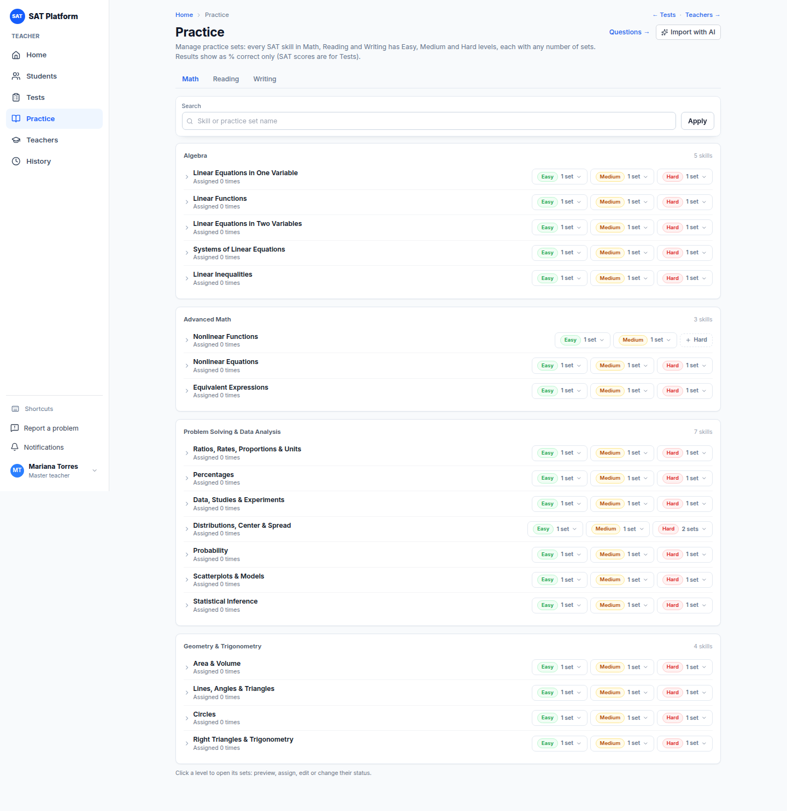
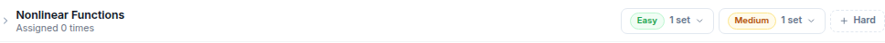
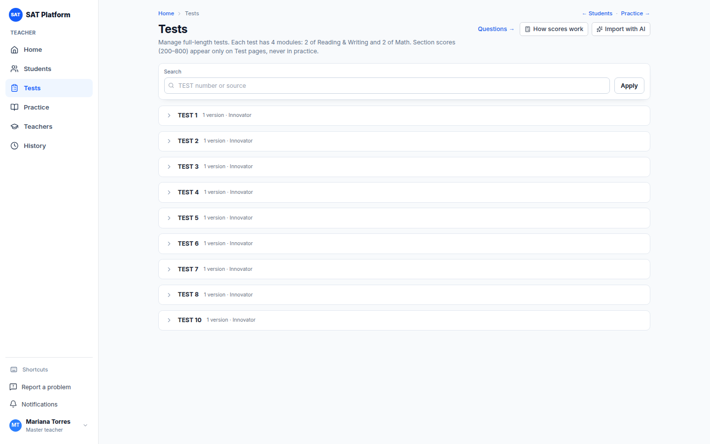
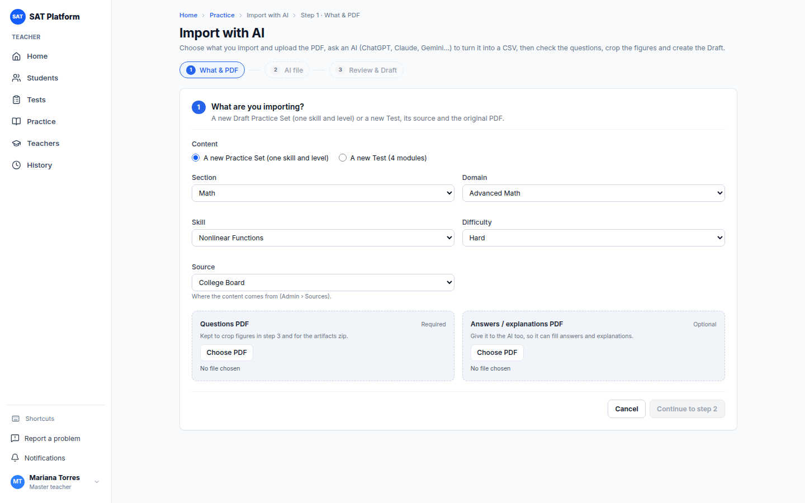
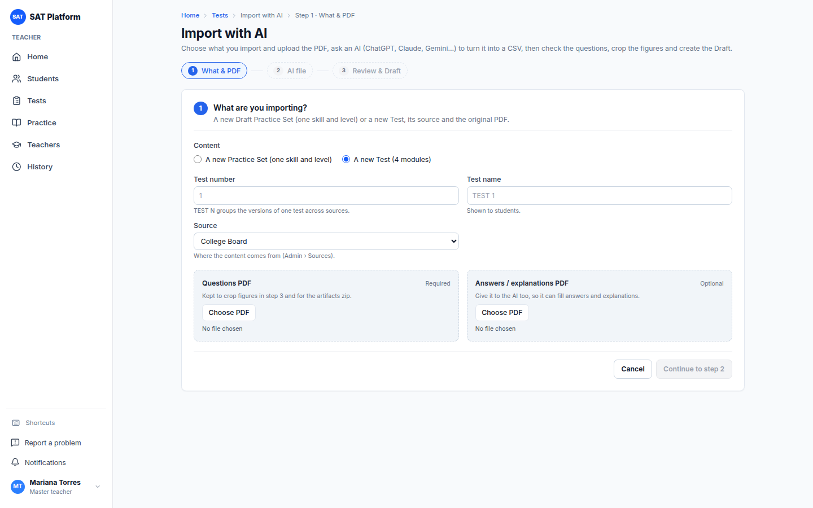
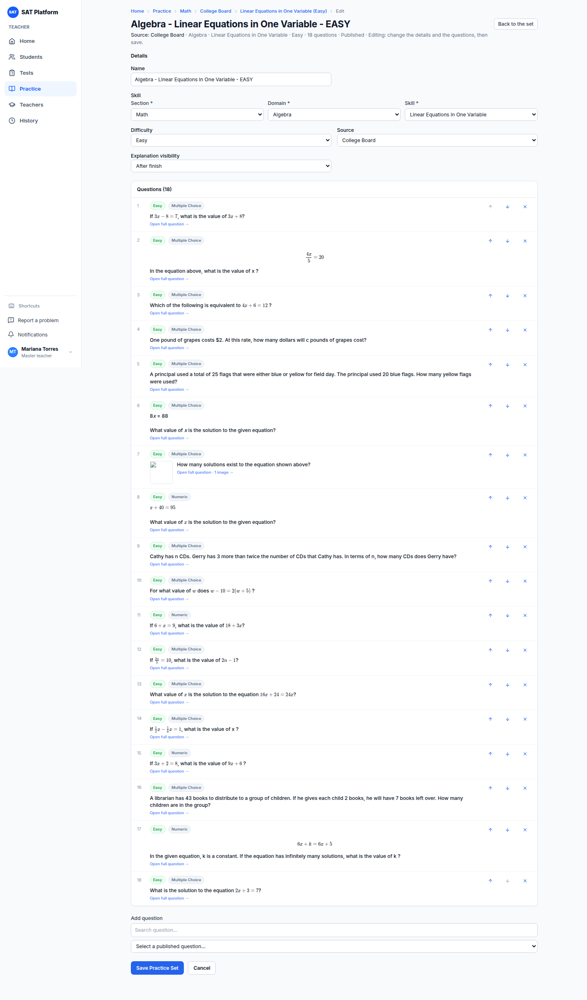
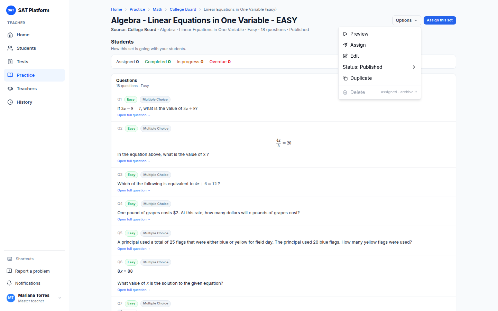
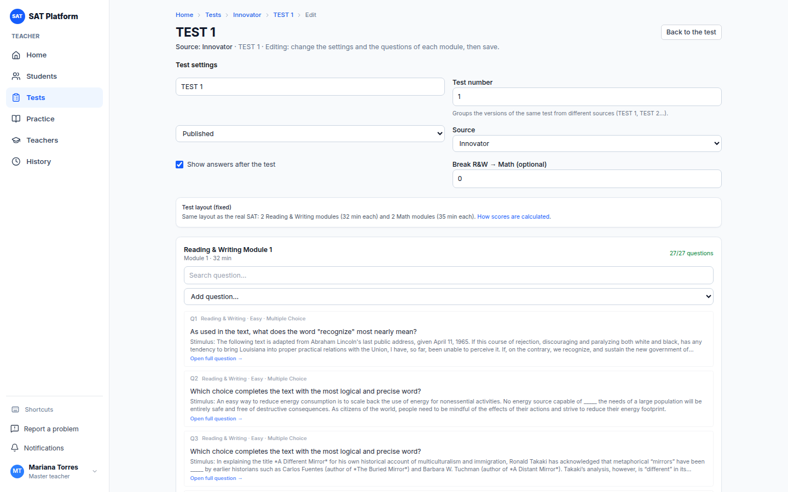
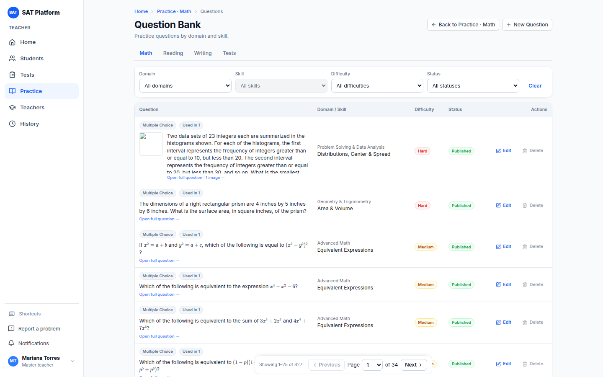
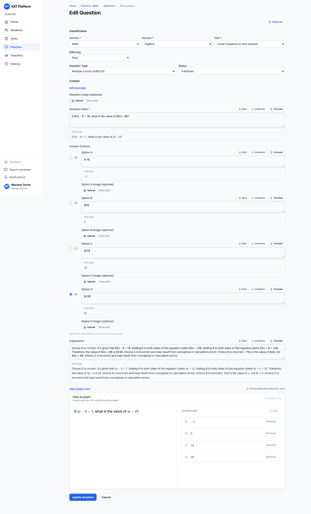

# Guía de importación y mantenimiento de sets con IA

Esta guía explica cómo cargar **contenido nuevo** (un Practice Set o un Test completo) a partir de un PDF usando una IA externa (ChatGPT, Claude, Gemini…), y cómo **mantener** después los sets, Tests y preguntas.

> Los pasos que se hacen fuera de la plataforma, en la IA externa, se marcan con **[CAPTURA PENDIENTE: …]**. Ahí falta añadir la captura real cuando se haga la primera importación.

## Contenido

1. [Quién puede importar y qué se necesita](#1-quién-puede-importar-y-qué-se-necesita)
2. [Encontrar el hueco a llenar](#2-encontrar-el-hueco-a-llenar)
3. [Paso 1 — Qué importas y el PDF](#3-paso-1--qué-importas-y-el-pdf)
4. [Paso 2 — Pedir el CSV a la IA](#4-paso-2--pedir-el-csv-a-la-ia)
5. [El archivo CSV: columnas y reglas](#5-el-archivo-csv-columnas-y-reglas)
6. [Paso 3 — Revisar, recortar figuras y crear el Draft](#6-paso-3--revisar-recortar-figuras-y-crear-el-draft)
7. [Publicar](#7-publicar)
8. [Mantenimiento de sets, Tests y preguntas](#8-mantenimiento-de-sets-tests-y-preguntas)
9. [Correcciones masivas de datos (equipo técnico)](#9-correcciones-masivas-de-datos-equipo-técnico)
10. [Problemas frecuentes](#10-problemas-frecuentes)

---

## 1. Quién puede importar y qué se necesita

- **Quién:** el **administrador** y el **profesor maestro**. Los demás profesores no ven **Import with AI**.
- **Qué se necesita:**
  - El **PDF de las preguntas** (obligatorio).
  - El **PDF de respuestas / explicaciones** (opcional, muy recomendado: la IA lo usa para llenar respuestas y explicaciones).
  - Una **fuente** activa (por ejemplo *College Board*, *Innovator*). Si no existe, un administrador la crea en **Admin › Sources**.
  - Acceso a una IA que **lea PDF y devuelva archivos** (ChatGPT, Claude o Gemini).

**Qué produce la importación:** siempre **un** Practice Set nuevo (una habilidad, un nivel, una fuente) **o un** Test nuevo (4 módulos, una fuente), en estado **Draft**. Nada se publica ni llega a los alumnos hasta que lo publiques (sección 7).

> Regla de contenido: hay **un set por fuente y nivel** en cada habilidad. Si un nivel ya tiene set para esa fuente, no se importa otro: se mantiene el existente (sección 8).

## 2. Encontrar el hueco a llenar

**Practice.** En el mapa de habilidades, un nivel que no tiene set aparece como **+ Hard** (o **+ Easy**, **+ Medium**). Al pulsarlo se abre la importación con la habilidad, el nivel y la fuente ya elegidos.

En el ejemplo, la habilidad *Nonlinear Functions* no tiene set **Hard**:





**Tests.** En **Tests** se ve qué números de Test (**TEST N**) existen. En el ejemplo falta **TEST 9**. Pulsa **Import with AI** para crearlo.



> También puedes abrir la importación directamente con **Import with AI** en **Practice** o **Tests** y elegirlo todo en el paso 1.

## 3. Paso 1 — Qué importas y el PDF

Arriba se ven los tres pasos: **What & PDF**, **AI file** y **Review & Draft**.

**Para un Practice Set:**

1. En **Content** marca **A new Practice Set (one skill and level)**.
2. Elige **Section** (Math, Reading o Writing), **Domain** (opcional, sirve para filtrar), **Skill** y **Difficulty**.
3. Elige la **Source**.
4. En **Questions PDF** pulsa **Choose PDF** y sube el PDF de las preguntas.
5. Opcional: en **Answers / explanations PDF** sube el PDF de respuestas.
6. Pulsa **Continue to step 2**.



**Para un Test:**

1. En **Content** marca **A new Test (4 modules)**.
2. Escribe el **Test number** (el N de **TEST N**; agrupa las versiones del mismo Test de distintas fuentes) y el **Test name** (lo ven los alumnos; por defecto "TEST N").
3. Elige la **Source** y sube los PDF como arriba.
4. Pulsa **Continue to step 2**.



> Si falta algo, el botón **Continue to step 2** queda bloqueado y al pasar el cursor dice qué falta (por ejemplo "Upload the questions PDF.").

## 4. Paso 2 — Pedir el CSV a la IA

La plataforma prepara un **prompt** (instrucciones en inglés) hecho a la medida de lo que importas: ya incluye la sección, el dominio, la habilidad y el nivel (o los 4 módulos del Test).

1. Pulsa **Copy prompt**. Con **See the prompt** puedes leerlo.

   [CAPTURA PENDIENTE: paso 2 "Ask an AI for the CSV" con el botón **Copy prompt**]

2. Abre tu IA, **adjunta los PDF** del paso 1, pega el prompt y envíalo.

   [CAPTURA PENDIENTE: chat de la IA con los PDF adjuntos y el prompt pegado]

3. La IA devuelve un archivo **import.csv**. Descárgalo. Si solo muestra texto en el chat, pídele de nuevo "send it as a downloadable file".

   [CAPTURA PENDIENTE: la IA entregando import.csv]

4. De vuelta en la plataforma, en **Upload the CSV** elige el archivo. Verás una **vista previa**: cuántas filas hay, cuántas se pueden importar, cuántas están listas sin cambios y cuántas tienen errores (estas se dejan fuera).

   [CAPTURA PENDIENTE: vista previa del CSV con la tabla Question / Problems]

5. Si la vista previa está bien, pulsa **Import N questions**. Si no, pulsa **Cancel**, corrige el CSV (o pídele a la IA que lo corrija) y súbelo otra vez. Mientras no se haya creado el Draft puedes subir otro con **Replace with a new CSV**.

**Imágenes (opcional): Reprocess with AI (artifacts and images).** Si hay muchas figuras, puedes pedirle a la IA que las recorte:

1. Descarga el zip (PDF original, cada página como imagen, las preguntas y los prompts).
2. Pulsa **Copy image prompt** y dáselo a la IA junto con el zip.
3. La IA devuelve un zip de imágenes con nombres como `Q3_STEM.png`, `Q5_A.png` (en Tests: `RW1_Q3_STEM.png`, `MATH2_Q12_A.png`).
4. Súbelo con **Upload images (zip)**: cada imagen va a su pregunta.

[CAPTURA PENDIENTE: panel "Reprocess with AI" con el zip de imágenes subido]

## 5. El archivo CSV: columnas y reglas

El prompt ya le explica todo esto a la IA. Esta sección sirve para revisar o corregir el CSV a mano.

**Formato:** UTF-8, separado por comas, cada campo entre comillas dobles. Primera línea, exactamente:

```
number,module,domain,skill,difficulty,type,stimulus,stem,optionA,optionB,optionC,optionD,correctAnswer,explanation,figure,figurePage,notes
```

| Columna | Qué lleva |
|---|---|
| `number` | Número de la pregunta tal como aparece en el PDF. |
| `module` | Solo Tests: `RW1`, `RW2`, `MATH1` o `MATH2`. En un Practice Set va vacío. La numeración empieza en 1 en cada módulo. |
| `domain`, `skill`, `difficulty` | Practice Set: los valores elegidos en el paso 1. En Tests son opcionales. |
| `type` | `MC` (4 opciones) o `NUMERIC` (respuesta escrita). |
| `stimulus` | El texto, pasaje o tabla al que se refiere la pregunta. Vacío si no hay. |
| `stem` | La pregunta en sí, sin las opciones. |
| `optionA` … `optionD` | El texto de cada opción, sin la letra. Vacío en `NUMERIC`. |
| `correctAnswer` | `MC`: una letra A–D. `NUMERIC`: el valor (`7/2` o `3.5`); varias respuestas válidas separadas por `\|`, por ejemplo `7/2\|3.5`. |
| `explanation` | La explicación del PDF de respuestas. Vacía si no hay (no se inventa). |
| `figure` | Dónde hay una figura que no se puede escribir como texto: `NONE`, `STEM`, `STIMULUS` u `OPTIONS`. |
| `figurePage` | Página del PDF donde está la figura (1 = primera). |
| `notes` | Dudas de la IA (texto ilegible, respuesta faltante…). |

**Matemáticas y formato:**

- Toda expresión matemática va en LaTeX entre `$…$`, por ejemplo `$\frac{3}{4}x + 2 = 11$`.
- Un signo de dólar de dinero se escribe `\$` (por ejemplo `\$12.50`).
- Las tablas van como tablas Markdown: `| x | y |`, `|---|---|`, `| 1 | 3 |`.

**Errores y avisos de la vista previa:**

- **Errores** (la fila **no se importa**):
  - `type` distinto de MC o NUMERIC;
  - `module` inválido en un Test;
  - pregunta repetida;
  - `stem` vacío sin figura;
  - en MC, una respuesta que no es A–D.
- **Avisos** (la fila se importa pero queda **Needs review**):
  - falta la respuesta;
  - menos de 4 opciones con texto;
  - hay una figura que recortar;
  - `$` desbalanceado (LaTeX roto);
  - una nota de la IA;
  - el nivel del CSV no coincide con el elegido (se usa el del paso 1).
- Faltan columnas obligatorias (`number`, `type`, `stem`, `correctAnswer`, y `module` en Tests): el CSV se rechaza entero.
- Límite: el CSV no puede pasar de **5.000.000 de caracteres**.

## 6. Paso 3 — Revisar, recortar figuras y crear el Draft

El paso 3 lista todas las preguntas importadas con su revisión (**Check**) y su estado:

- **Ready**: lista, sin problemas.
- **Needs review**: hay algo que mirar (respuesta faltante, figura, opciones incompletas…).
- **Reviewed**: la marcaste como revisada.
- **In the Draft**: ya está en el Draft creado.

[CAPTURA PENDIENTE: paso 3 "Review, crop figures and create the Draft" con la tabla de preguntas]

1. Pulsa **Open Review (edit and crop)**.
2. En cada pregunta con problemas corrige el texto, las opciones o la respuesta.
3. Si tiene figura: **Crop** sobre la página del PDF y asígnala a la pregunta, al pasaje o a una opción.
4. Marca la pregunta como **Reviewed**.

   [CAPTURA PENDIENTE: Review con el recorte de una figura del PDF]

5. Vuelve al paso 3 y pulsa **Create Draft Practice Set** (o **Create Draft Test**).

Solo entran al Draft las preguntas **Ready** o **Reviewed**. Si quedan otras, la plataforma pregunta **Create a partial Draft?**: con **Create partial Draft** se crea el Draft con las que están listas, y las demás se quedan en la importación para revisarlas después.

Al terminar se abre el Draft. Más tarde puedes volver con **Open the Draft**.

[CAPTURA PENDIENTE: el Draft recién creado]

## 7. Publicar

El Draft no lo ven los alumnos. Para publicarlo:

1. **Primero las preguntas.** En el **Question Bank** (o desde el editor del set/Test) cambia las preguntas del Draft a **Published**. Un set o Test solo se publica con preguntas publicadas.
2. **Después el set o Test.** Ábrelo, pulsa **Options → Status** y elige **Published**.
3. **Regla de los Tests:** para publicar, cada módulo debe tener exactamente **27 / 27 / 22 / 22** preguntas (R&W 1, R&W 2, Math 1, Math 2), sin repetidas entre módulos y cada una en su sección. Mientras falten, el editor avisa "currently has N/27…".

[CAPTURA PENDIENTE: cambiar el estado del set importado a Published]

Una vez publicado, el set ocupa su nivel en **Practice** (el chip **+ Hard** desaparece) y se puede asignar.

## 8. Mantenimiento de sets, Tests y preguntas

### Editar un set

En **Practice**, pulsa el nivel y luego **Edit** (o abre el set y **Options → Edit**). Puedes cambiar:

- **Name**, **Section**, **Domain**, **Skill**, **Difficulty** y **Source**.
- **Explanation visibility**: cuándo ve el alumno las explicaciones (por ejemplo **After finish**).
- Las preguntas: subirlas o bajarlas (flechas), quitarlas (×) o añadir una publicada en **Add question**.

Pulsa **Save Practice Set** (o **Cancel**).



El menú **Options** del set tiene **Preview** (verlo como alumno), **Assign**, **Edit**, **Status** (Draft / Published / Archived), **Duplicate** y **Delete** (bloqueado si ya se asignó: "assigned · archive it").



### Editar un Test

Abre el Test y pulsa **Options → Edit**. Se editan sus datos (nombre, número, fuente) y las preguntas de cada módulo.



### Editar una pregunta

En el **Question Bank** abre la pregunta. Puedes cambiar el pasaje, el enunciado, las opciones, la respuesta correcta, la explicación, la imagen, la habilidad, la dificultad y el estado. Usa `$…$` para las matemáticas, igual que en el CSV.





> Corregir una pregunta **no cambia los resultados anteriores**: cada intento guarda una copia de las preguntas tal como estaban al entregarlo.

### Estados

- **Draft**: en preparación; los alumnos no lo ven.
- **Published**: disponible para asignar.
- **Archived**: retirado. No se puede asignar, pero se conservan los intentos e informes.

El estado se cambia en **Options → Status**. **Delete** solo está disponible si el set **nunca se asignó**; si ya se asignó, archívalo (**Status → Archived**).

### Duplicar

**Duplicate** crea una copia en **Draft** para preparar una versión nueva sin tocar la publicada.

### Fuentes

Cada set y Test pertenece a una **fuente**. Un administrador las gestiona en **Admin › Sources**: crearlas, renombrarlas y desactivarlas. En **Assign**, cada fuente es una fila dentro de la habilidad.

### Imágenes y archivos de origen

En el editor de un set o Test **importado** aparece el recuadro **Images & source files** con **Open**: ahí están el zip con el PDF original y las páginas, el prompt de imágenes y la subida del zip de imágenes (igual que en el paso 2). Cada pregunta tiene además **Images / crop** para recortar su figura del PDF.

[CAPTURA PENDIENTE: recuadro "Images & source files" en el editor de un set importado]

### "Someone else changed this since you opened it"

Si dos personas editan lo mismo a la vez, al guardar la segunda aparece este aviso y **no se guarda nada**. Recarga la página para ver los cambios de la otra persona y vuelve a hacer los tuyos.

## 9. Correcciones masivas de datos (equipo técnico)

Para corregir muchas preguntas a la vez (por ejemplo, la misma errata en 200 preguntas) no se edita la base de datos a mano. El equipo técnico crea un **data patch**: un archivo en `prisma/data-patches/` que se aplica automáticamente, una sola vez, en el siguiente despliegue. Si falla, el despliegue se revierte solo. Detalles en `prisma/data-patches/README.md`.

## 10. Problemas frecuentes

**No veo Import with AI.**
Solo el administrador y el profesor maestro lo ven.

**"No active source for this kind of content".**
No hay fuente activa. Pide a un administrador que la cree en **Admin › Sources**.

**La IA respondió con texto y no con un archivo.**
Pídele "send it as a downloadable file". Si no puede, copia el bloque de código en un archivo `import.csv` (UTF-8).

**Muchas filas con error.**
Revisa que la primera línea sea exactamente la cabecera de la sección 5 y que `type` y `correctAnswer` sigan las reglas. Puedes pegar los errores en la IA y pedirle que corrija el CSV.

**Las fórmulas se ven raras.**
Busca `$` sin cerrar (aviso "unbalanced $"). Recuerda que el dinero se escribe `\$`.

**"All questions must be published before publishing a Practice Set."**
Publica primero las preguntas del set (sección 7, paso 1).

**El Test no se deja publicar.**
Revisa que cada módulo tenga exactamente 27 / 27 / 22 / 22 preguntas publicadas.
