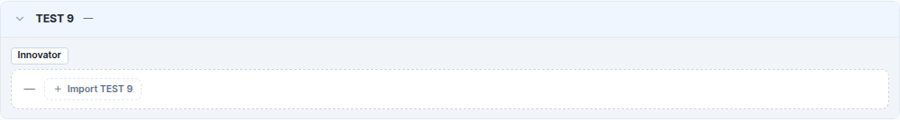
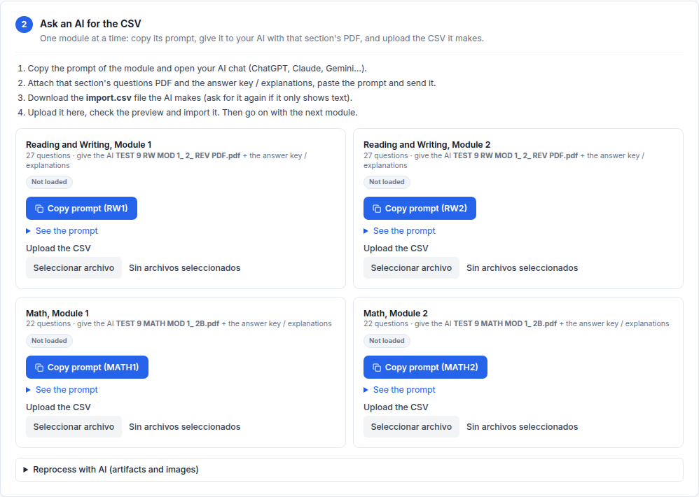
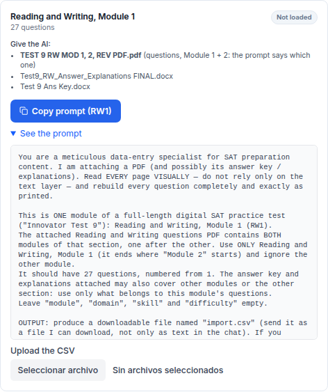
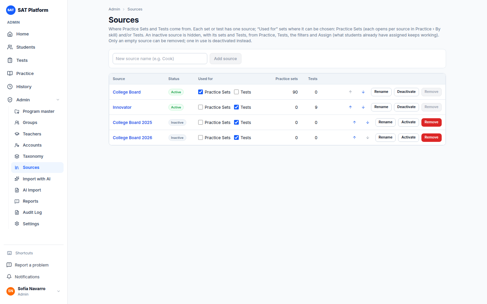

# Guía de importación y mantenimiento de sets con IA

Esta guía explica cómo cargar **contenido nuevo** con ayuda de una IA externa (ChatGPT, Claude, Gemini…) a partir de los archivos originales:

- un **Practice Set** de una habilidad y una dificultad concretas;
- un **Test** completo, **módulo por módulo** (Reading & Writing 1 y 2, Math 1 y 2).

También explica cómo **refinar** lo cargado y **mantener** después los sets, Tests y preguntas.

> Los pasos que se hacen en la IA externa, o que dependen de su resultado, se marcan con **[CAPTURA PENDIENTE: …]**. Ahí falta añadir la captura real cuando se haga la primera importación.

## Contenido

1. [Quién puede importar y qué se necesita](#1-quién-puede-importar-y-qué-se-necesita)
2. [Qué archivos tienes y en qué bandeja va cada uno](#2-qué-archivos-tienes-y-en-qué-bandeja-va-cada-uno)
3. [Encontrar el hueco a llenar](#3-encontrar-el-hueco-a-llenar)
4. [Cargar un Practice Set (una habilidad y una dificultad)](#4-cargar-un-practice-set-una-habilidad-y-una-dificultad)
5. [Cargar un Test, módulo por módulo](#5-cargar-un-test-módulo-por-módulo)
6. [El archivo CSV: columnas y reglas](#6-el-archivo-csv-columnas-y-reglas)
7. [Refinar: revisar y recortar figuras](#7-refinar-revisar-y-recortar-figuras)
8. [Publicar](#8-publicar)
9. [Mantenimiento de sets, Tests y preguntas](#9-mantenimiento-de-sets-tests-y-preguntas)
10. [Correcciones masivas de datos (equipo técnico)](#10-correcciones-masivas-de-datos-equipo-técnico)
11. [Problemas frecuentes](#11-problemas-frecuentes)

---

## 1. Quién puede importar y qué se necesita

- **Quién:** el **administrador** y el **profesor maestro**. Los demás profesores no ven **Import with AI**.
- **Qué se necesita:**
  - Los **archivos** del set o del Test, tal como los tengas (sección 2). Solo se suben archivos: la plataforma no mira nombres ni carpetas.
  - Una **fuente** activa. Hoy los Practice Sets son de **College Board** y los Tests de **Innovator**. Si hace falta otra, un administrador la crea en **Admin › Sources**.
  - Una IA que **lea PDF y Word y devuelva archivos** (ChatGPT, Claude o Gemini).

**Qué produce la importación:** siempre **un** Practice Set nuevo (una habilidad, un nivel, una fuente) **o un** Test nuevo (4 módulos, una fuente), en estado **Draft**. Nada llega a los alumnos hasta que lo publiques (sección 8).

> Regla de contenido: hay **un set por fuente y nivel** en cada habilidad, y **una versión por fuente** de cada TEST N. Si ya existe, no se importa otro: se mantiene el existente (sección 9).

## 2. Qué archivos tienes y en qué bandeja va cada uno

En el paso 1 **cada archivo va en una casilla**. Lo que la plataforma sabe de cada archivo (si son preguntas o respuestas, de qué sección, de qué módulo) sale **de la casilla donde lo pones y de las opciones que eliges**, nunca de su nombre. Un archivo de preguntas que se llame "ANS…" sigue siendo de preguntas si lo pones en una casilla de preguntas.

### Practice Set

Normalmente tienes **un PDF de preguntas** del nivel y **un archivo de respuestas y explicaciones** de ese mismo nivel.

| Archivo (ejemplo) | Qué contiene | Casilla del paso 1 |
|---|---|---|
| `NON LINEAR FUNCTIONS HARD.pdf` | Las preguntas del nivel Hard | **Questions PDF** |
| `ANS NON LINEAR FUNCT HARD .pdf` | Respuestas y explicaciones de ese nivel | **Answers / explanations** |

### Test

El paso 1 tiene **dos bandejas, una por sección**: **Reading and Writing** y **Math**. En cada bandeja eliges cómo vienen sus preguntas:

- **One file, Module 1 + 2**: un solo PDF con los dos módulos, uno detrás de otro (lo habitual). Hay una casilla de preguntas.
- **One file per module**: un PDF con el Módulo 1 y otro con el Módulo 2. Hay dos casillas: **Module 1 questions** y **Module 2 questions**.

Cada bandeja tiene además su casilla **Answers / explanations**, para las respuestas y explicaciones de **esa sección** (PDF o Word, varios archivos). Debajo de las dos bandejas está **Answer key for the whole Test**, para una clave de respuestas que cubre las dos secciones.

Ejemplo, TEST 9:

| Archivo | Qué contiene | Dónde va |
|---|---|---|
| `TEST 9 RW MOD 1, 2, REV PDF.pdf` | R&W, Módulo 1 y Módulo 2 | Bandeja **Reading and Writing** · **One file, Module 1 + 2** |
| `Test9_RW_Answer_Explanations FINAL.docx` | Explicaciones de R&W | Bandeja **Reading and Writing** · **Answers / explanations** |
| `TEST 9 MATH MOD 1, 2B.pdf` | Math, Módulo 1 y Módulo 2 (2B "harder") | Bandeja **Math** · **One file, Module 1 + 2** |
| `Test9_Math ANS Explanations.docx` | Explicaciones de Math | Bandeja **Math** · **Answers / explanations** |
| `Test 9 Ans Key.docx` | Clave de los 4 módulos | **Answer key for the whole Test** |

Si una sección viene **en un archivo por módulo** (por ejemplo `Math Module 1.pdf` y `Math Module 2.pdf`), elige **One file per module** en esa bandeja y pon cada archivo en su casilla.

Un Test de la plataforma tiene **4 módulos** con un número fijo de preguntas:

| Módulo | Preguntas |
|---|---|
| Reading and Writing, Module 1 (RW1) | 27 |
| Reading and Writing, Module 2 (RW2) | 27 |
| Math, Module 1 (MATH1) | 22 |
| Math, Module 2 (MATH2) | 22 |

**Casos especiales:**

- **Módulo 2A y 2B.** Algunos PDF traen dos versiones del Módulo 2. La plataforma usa la **2B (la difícil)**; el prompt ya se lo indica a la IA.
- **Una sección en Word.** Si las preguntas vienen en `.docx`, ábrelo y guárdalo como PDF (**Archivo › Guardar como › PDF**) antes del paso 1. Las casillas de preguntas solo aceptan PDF, para poder recortar figuras.
- **Solo una sección.** Puedes subir solo R&W o solo Math. Los módulos de la sección vacía quedan bloqueados en esa importación.

## 3. Encontrar el hueco a llenar

El botón **Import with AI** de **Practice** y de **Tests** solo aparece mientras haya algo por cargar en las fuentes activas:

- **Practice:** alguna habilidad y nivel sin set en alguna fuente activa de Practice Sets (en cualquier área, no solo la pestaña abierta).
- **Tests:** a alguna fuente activa de Tests le falta un número entre el TEST 1 y el más alto (o todavía no hay ningún Test).

Si todo está completo, el botón desaparece. Para cargar más contenido hace falta un hueco: por ejemplo, un administrador crea o activa otra fuente en **Admin › Sources**. El enlace **Import with AI** del menú de administración sigue disponible para casos especiales.

**Practice.** En el mapa de habilidades, un nivel que no tiene set en ninguna fuente aparece como **Hard —** en la fila de la habilidad. Al abrir la habilidad se ve una fila por fuente: ahí el nivel vacío aparece como **+ Hard** (o **+ Easy**, **+ Medium**). Al pulsarlo se abre la importación con la habilidad, el nivel y la fuente ya elegidos. Los niveles que ya tienen sets no muestran **+**.

En el ejemplo, la habilidad *Nonlinear Functions* tiene Easy y Medium, pero no **Hard**:


**Tests.** En **Tests** aparecen todos los números, del **TEST 1** al más alto. Un número que ninguna fuente tiene se ve con **—**; en el ejemplo, **TEST 9**. Al abrirlo, cada fuente de Tests ofrece **+ Import TEST 9**, que abre la importación con el número y la fuente ya elegidos. Dentro de un TEST que ya existe, las fuentes que no lo tienen también ofrecen **+ Import TEST N**.




## 4. Cargar un Practice Set (una habilidad y una dificultad)

Ejemplo: *Advanced Math › Nonlinear Functions › Hard*, fuente College Board.

### Paso 1 — What & PDF

1. Abre la habilidad y pulsa **+ Hard** en la fila de la fuente. La importación se abre con **Section**, **Domain**, **Skill**, **Difficulty** y **Source** ya elegidos. Si entraste por **Import with AI**, marca **A new Practice Set (one skill and level)** y elígelos tú.
2. Revisa la **Source** (College Board).
3. En **Questions PDF** pulsa **Choose PDF** y elige `NON LINEAR FUNCTIONS HARD.pdf`.
4. En **Answers / explanations** elige `ANS NON LINEAR FUNCT HARD .pdf` (acepta PDF o Word, uno o varios).
5. Pulsa **Continue to step 2**.


> Si falta algo, **Continue to step 2** queda bloqueado y, al pasar el cursor, dice qué falta.

### Paso 2 — AI file

1. Pulsa **Copy prompt**. El prompt ya dice la sección, el dominio, la habilidad y el nivel. Con **See the prompt** puedes leerlo.
2. Abre tu IA, adjunta **los dos PDF** del paso 1, pega el prompt y envíalo.

   [CAPTURA PENDIENTE: chat de la IA con los dos PDF adjuntos y el prompt pegado]

3. La IA devuelve un archivo **import.csv**. Descárgalo. Si solo muestra texto, pídele "send it as a downloadable file".

   [CAPTURA PENDIENTE: la IA entregando import.csv]

4. En la plataforma, en **Upload the CSV**, elige el archivo. Verás una **vista previa**: filas, cuántas se pueden importar, cuántas están listas y cuáles tienen errores o avisos (sección 6).

   [CAPTURA PENDIENTE: vista previa del CSV del set]

5. Si está bien, pulsa **Import N questions**. Si no, pulsa **Cancel**, pide a la IA que corrija el CSV y súbelo otra vez. Hasta crear el Draft puedes cambiarlo con **Replace with a new CSV**.

### Paso 3 — Review & Draft

1. Refina las preguntas en **Open Review (edit and crop)** (sección 7).
2. Pulsa **Create Draft Practice Set**. Se crea el set *Advanced Math - Nonlinear Functions - HARD* en **Draft** y se abre su editor.

   [CAPTURA PENDIENTE: el Draft del set recién creado]

3. Publícalo (sección 8).

## 5. Cargar un Test, módulo por módulo

Ejemplo: **TEST 9**, fuente Innovator. El Test se crea una vez y se llena **un módulo a la vez**. Puedes hacer un módulo hoy y otro mañana: la importación queda guardada.

### Paso 1 — Todos los archivos del Test

1. En **Tests** abre **TEST 9** y pulsa **+ Import TEST 9** en la fila de **Innovator**: la importación se abre con **A new Test (4 modules)**, **Test number** `9` y **Source** Innovator ya elegidos. (También puedes pulsar **Import with AI**, marcar **A new Test (4 modules)** y llenarlos tú.)
2. **Test number**: `9`. **Test name** se llena solo con "TEST 9" (es lo que ven los alumnos).
3. **Source**: Innovator.
4. Bandeja **Reading and Writing**:
   - en **Questions come as** deja **One file, Module 1 + 2**;
   - en **Questions (Module 1 + 2)**, el PDF de R&W;
   - en **Answers / explanations**, las explicaciones de R&W.
5. Bandeja **Math**: lo mismo con el PDF de Math y sus explicaciones. Si Math viniera en dos archivos, elige **One file per module** y usa **Module 1 questions** y **Module 2 questions**.
6. En **Answer key for the whole Test**, la clave de respuestas única (`Test 9 Ans Key.docx`).
7. Pulsa **Continue to step 2**.


### Paso 2 — Un módulo a la vez

El paso 2 muestra **4 tarjetas**, una por módulo. Cada tarjeta dice cuántas preguntas debe tener, cómo va (**Not loaded**, **27/27 loaded · 27 ready**, **In the Draft**) y, en **Give the AI**, **exactamente qué archivos darle a la IA**: el de preguntas de ese módulo, las respuestas y explicaciones de su sección, y la clave común.



Para **cada módulo**, en este orden: R&W 1 → R&W 2 → Math 1 → Math 2:

1. Pulsa **Copy prompt (RW1)** (o el del módulo). El prompt le dice a la IA **qué módulo** sacar del PDF, cuántas preguntas debe tener y que ignore el otro módulo.

   

2. Abre **una conversación nueva** en tu IA. Adjunta **los archivos de "Give the AI"** de la tarjeta, pega el prompt y envíalo.

   [CAPTURA PENDIENTE: chat de la IA con el PDF de R&W, los Word y el prompt de RW1]

3. Descarga el **import.csv** que devuelve.

   [CAPTURA PENDIENTE: la IA entregando el import.csv de RW1]

4. En la tarjeta del módulo, en **Upload the CSV**, elige el archivo y revisa la vista previa. **Fíjate en el número de preguntas.** Si no coincide (por ejemplo 21 de 22), la vista previa avisa: "This module should have 22 questions and the CSV brings 21". Pide a la IA que revise qué pregunta saltó o si mezcló módulos.

   [CAPTURA PENDIENTE: vista previa del CSV de RW1 con 27 filas]

5. Pulsa **Import N questions**. La tarjeta pasa a **27/27 loaded**.
6. Sigue con el siguiente módulo.

> **Rehacer un módulo:** mientras el módulo no esté en el Draft, sube otro CSV con **Replace with a new CSV**. Solo se reemplaza **ese** módulo; los demás no se tocan.

> **Una conversación por módulo:** pedirle a la IA un módulo a la vez evita respuestas cortadas y mezclas entre módulos. Si tu IA lo permite, puedes seguir en la misma conversación con el prompt del módulo siguiente.

### Paso 3 — Refinar y armar el Draft del Test

1. Refina cada módulo (sección 7). Hay un botón de revisión por archivo de preguntas: **Review Reading and Writing** y **Review Math** (o **Review Math · Module 1** y **· Module 2** si Math vino en dos archivos). Cada uno abre su PDF, para recortar las figuras de ahí.
2. Cuando tengas módulos listos, pulsa **Create Draft Test**. Se crea **TEST 9** en Draft con los módulos cargados hasta ese momento.

   [CAPTURA PENDIENTE: paso 3 del Test con los módulos cargados]

3. ¿Cargaste más módulos después? Vuelve a la importación (paso 2, el módulo siguiente) y, en el paso 3, pulsa **Add N questions to the Draft**. Se agregan a su módulo dentro del mismo TEST 9, sin repetir lo que ya estaba.
4. Cuando el Draft tenga los 4 módulos completos (27 / 27 / 22 / 22), publícalo (sección 8).

> **Refina antes de llevar un módulo al Draft.** Un módulo que ya está en el Draft no acepta otro CSV. Después:
> - los **recortes de figuras** en **Review** siguen pasando a sus preguntas del Draft;
> - los **textos, opciones y respuestas** se corrigen en el editor de la pregunta (desde el editor del Test o el **Question Bank**);
> - el **orden** o **quitar** preguntas se hace en el editor del Test.

## 6. El archivo CSV: columnas y reglas

El prompt ya le explica todo esto a la IA. Esta sección sirve para revisar o corregir el CSV a mano.

**Formato:** UTF-8, separado por comas, cada campo entre comillas dobles. La primera línea es exactamente:

```
number,module,domain,skill,difficulty,type,stimulus,stem,optionA,optionB,optionC,optionD,correctAnswer,explanation,figure,figurePage,notes
```

| Columna | Qué lleva |
|---|---|
| `number` | Número de la pregunta tal como aparece en el PDF. En un Test empieza en 1 en cada módulo. |
| `module` | Vacío: el módulo lo da la tarjeta donde subes el CSV. |
| `domain`, `skill`, `difficulty` | Practice Set: los valores elegidos en el paso 1. En Tests van vacíos. |
| `type` | `MC` (4 opciones) o `NUMERIC` (respuesta escrita). |
| `stimulus` | El texto, pasaje o tabla al que se refiere la pregunta. Vacío si no hay. |
| `stem` | La pregunta en sí, sin las opciones. |
| `optionA` … `optionD` | El texto de cada opción, sin la letra. Vacío en `NUMERIC`. |
| `correctAnswer` | `MC`: una letra A–D. `NUMERIC`: el valor (`7/2` o `3.5`); varias respuestas válidas separadas por `\|`, por ejemplo `7/2\|3.5`. |
| `explanation` | La explicación de los archivos de respuestas. Vacía si no hay (no se inventa). |
| `figure` | Dónde hay una figura que no se puede escribir como texto: `NONE`, `STEM`, `STIMULUS` u `OPTIONS`. |
| `figurePage` | Página del PDF donde está la figura (1 = primera). |
| `notes` | Dudas de la IA (texto ilegible, respuesta faltante…). |

**Matemáticas y formato:**

- Toda expresión matemática va en LaTeX entre `$…$`, por ejemplo `$\frac{3}{4}x + 2 = 11$`.
- Un signo de dólar de dinero se escribe `\$` (por ejemplo `\$12.50`).
- Las tablas van como tablas Markdown: `| x | y |`, `|---|---|`, `| 1 | 3 |`.

**Errores y avisos de la vista previa:**

- **Errores** (la fila **no se importa**):
  - `type` distinto de MC o NUMERIC;
  - pregunta repetida;
  - `stem` vacío sin figura;
  - en MC, una respuesta que no es A–D.
- **Avisos** (la fila se importa, pero queda **Needs review**):
  - falta la respuesta;
  - menos de 4 opciones con texto;
  - hay una figura que recortar;
  - `$` desbalanceado (LaTeX roto);
  - una nota de la IA;
  - el nivel del CSV no coincide con el elegido (se usa el del paso 1).
- Faltan columnas obligatorias (`number`, `type`, `stem`, `correctAnswer`): el CSV se rechaza entero.
- En un Test, la vista previa avisa si el número de preguntas no es el del módulo (27 o 22).
- Límite: el CSV no puede pasar de **5.000.000 de caracteres**.

## 7. Refinar: revisar y recortar figuras

El paso 3 lista las preguntas cargadas (en un Test, con su módulo: `RW1 · 3`, `MATH2 · 12`…), con su revisión (**Check**) y su estado:

- **Ready**: lista, sin problemas.
- **Needs review**: hay algo que mirar (respuesta faltante, figura, opciones incompletas…).
- **Reviewed**: la marcaste como revisada.
- **In the Draft**: ya está en el Draft.

Para refinar:

1. Pulsa **Open Review (edit and crop)**. En un Test, el **Review** del archivo de esa pregunta. También puedes pulsar el texto de una pregunta en la tabla.
2. Corrige el texto, las opciones, la respuesta o la explicación.
3. Si tiene figura: **Crop** sobre la página del PDF y asígnala a la pregunta, al pasaje o a una opción. La columna `figurePage` del CSV dice en qué página está.
4. Marca la pregunta como **Reviewed**.

   [CAPTURA PENDIENTE: Review con el recorte de una figura del PDF]

> Haz estas correcciones **antes de crear el Draft** (o, en un Test, antes de añadir el módulo al Draft). Después, los recortes de figuras siguen pasando al Draft, pero los textos y respuestas se corrigen en el editor de la pregunta (sección 9).

Solo entran al Draft las preguntas **Ready** o **Reviewed**. Si quedan otras, la plataforma pregunta si quieres seguir solo con las listas: **Create partial Draft** (o **Add the ready ones**). Las demás se quedan en la importación para agregarlas después.

**Muchas figuras: Reprocess with AI (artifacts and images).** En el paso 2 puedes pedirle a la IA que recorte las figuras por ti:

1. Descarga el zip (PDF original, cada página como imagen, las preguntas y los prompts).
2. Pulsa **Copy image prompt** y dáselo a la IA junto con el zip.
3. La IA devuelve un zip de imágenes con nombres como `Q3_STEM.png` o `Q5_A.png` (en Tests: `RW1_Q3_STEM.png`, `MATH2_Q12_A.png`).
4. Súbelo con **Upload images (zip)**: cada imagen va a su pregunta.

[CAPTURA PENDIENTE: panel "Reprocess with AI" con el zip de imágenes subido]

## 8. Publicar

El Draft no lo ven los alumnos. Para publicarlo:

1. **Primero las preguntas.** En el **Question Bank** (o desde el editor del set o Test) cambia las preguntas del Draft a **Published**. Un set o Test solo se publica con preguntas publicadas.
2. **Después el set o Test.** Ábrelo, pulsa **Options → Status** y elige **Published**.
3. **Regla de los Tests:** cada módulo debe tener exactamente **27 / 27 / 22 / 22** preguntas (R&W 1, R&W 2, Math 1, Math 2), sin repetidas entre módulos y cada una en su sección. Mientras falten, el editor avisa "currently has N/27…".

[CAPTURA PENDIENTE: cambiar el estado del set importado a Published]

Una vez publicado, el set ocupa su nivel en **Practice** (el **+ Hard** de la fuente desaparece) o el **TEST 9** muestra su versión en lugar de **—**, y se puede asignar.

## 9. Mantenimiento de sets, Tests y preguntas

### Editar un set

En **Practice**, pulsa el nivel y luego **Edit** (o abre el set y **Options → Edit**). Puedes cambiar:

- **Name**, **Section**, **Domain**, **Skill**, **Difficulty** y **Source**.
- **Explanation visibility**: cuándo ve el alumno las explicaciones (por ejemplo **After finish**).
- Las preguntas: subirlas o bajarlas (flechas), quitarlas (×) o añadir una publicada en **Add question**.

Pulsa **Save Practice Set** (o **Cancel**).


El menú **Options** del set tiene **Preview** (verlo como alumno), **Assign**, **Edit**, **Status** (Draft / Published / Archived), **Duplicate** y **Delete**. **Delete** está bloqueado si el set ya se asignó ("assigned · archive it").


### Editar un Test

Abre el Test y pulsa **Options → Edit**. Se editan sus datos (nombre, número, fuente) y las preguntas de cada módulo: orden, quitar y añadir.


### Editar una pregunta

En el **Question Bank** abre la pregunta. Puedes cambiar:

- el pasaje, el enunciado y las opciones;
- la respuesta correcta y la explicación;
- la imagen;
- la habilidad, la dificultad y el estado.

Usa `$…$` para las matemáticas, igual que en el CSV.


> Corregir una pregunta **no cambia los resultados anteriores**: cada intento guarda una copia de las preguntas tal como estaban al entregarlo.

### Estados

- **Draft**: en preparación; los alumnos no lo ven.
- **Published**: disponible para asignar.
- **Archived**: retirado. No se puede asignar, pero se conservan los intentos y los informes.

El estado se cambia en **Options → Status**. **Delete** solo está disponible si el set **nunca se asignó**; si ya se asignó, archívalo (**Status → Archived**).

### Duplicar

**Duplicate** crea una copia en **Draft** para preparar una versión nueva sin tocar la publicada.

### Fuentes

Cada set y Test pertenece a una **fuente**. Un administrador las gestiona en **Admin › Sources**:

- **Add source**, **Rename** y el orden (flechas).
- **Used for**: si la fuente se ofrece para **Practice Sets**, para **Tests** o para ambos. Solo las fuentes marcadas para Tests aparecen con **+ Import TEST N** en **Tests**.
- **Deactivate / Activate**: una fuente inactiva desaparece, con sus sets y Tests, de **Practice**, **Tests**, los filtros y **Assign**; ya no se puede asignar ni importar nada en ella. Lo que los alumnos ya tienen asignado sigue funcionando (pueden terminarlo y ver sus resultados). Al reactivarla, todo vuelve a verse.
- **Remove** (dar de baja): solo para una fuente vacía (sin sets, Tests ni importaciones). Si tiene contenido, el botón está bloqueado y hay que desactivarla.

Hoy los Practice Sets son de **College Board** y los Tests de **Innovator**; College Board 2025 y 2026 están inactivas.



En **Assign**, cada fuente activa es una fila dentro de la habilidad o del TEST N.

### Imágenes y archivos de origen

En el editor de un set o Test **importado** aparece el recuadro **Images & source files** con **Open**. Ahí están:

- el zip con los archivos originales y sus páginas;
- el prompt de imágenes;
- la subida del zip de imágenes (igual que en la sección 7).

Cada pregunta tiene además **Images / crop**, para recortar su figura del PDF.

[CAPTURA PENDIENTE: recuadro "Images & source files" en el editor de un set importado]

### "Someone else changed this since you opened it"

Si dos personas editan lo mismo a la vez, al guardar la segunda aparece este aviso y **no se guarda nada**. Recarga la página para ver los cambios de la otra persona y vuelve a hacer los tuyos. También aparece si tenías abierto el editor de un Test mientras se le agregaba un módulo desde la importación.

## 10. Correcciones masivas de datos (equipo técnico)

Para corregir muchas preguntas a la vez (por ejemplo, la misma errata en 200 preguntas) no se edita la base de datos a mano. El equipo técnico crea un **data patch**: un archivo en `prisma/data-patches/` que se aplica automáticamente, una sola vez, en el siguiente despliegue. Si falla, el despliegue se revierte solo. Los detalles están en `prisma/data-patches/README.md`.

## 11. Problemas frecuentes

**No veo Import with AI.**
Solo el administrador y el profesor maestro lo ven.

**"No active source for this kind of content".**
No hay fuente activa. Pide a un administrador que la cree en **Admin › Sources**.

**"The import service is not available".**
El servicio que guarda los archivos no responde. Espera unos minutos y vuelve a intentarlo; si sigue, avisa al equipo técnico.

**La IA respondió con texto y no con un archivo.**
Pídele "send it as a downloadable file". Si no puede, copia el bloque de código en un archivo `import.csv` (UTF-8).

**El módulo trae menos (o más) preguntas de las que debe.**
La IA se saltó una pregunta o tomó preguntas del otro módulo. Pídele que revise: "Module 1 should have 27 questions; check which one is missing". Después sube el CSV corregido con **Replace with a new CSV**.

**Muchas filas con error.**
Revisa que la primera línea sea exactamente la cabecera de la sección 6 y que `type` y `correctAnswer` sigan las reglas. Puedes pegar los errores en la IA y pedirle que corrija el CSV.

**Las fórmulas se ven raras.**
Busca `$` sin cerrar (aviso "unbalanced $"). Recuerda que el dinero se escribe `\$`.

**"… is already in the Draft".**
Ese módulo ya está en el Draft del Test y no acepta otro CSV. Corrige sus preguntas en el editor del Test (o recorta figuras en **Review**).

**"The Test is no longer a Draft".**
El Test ya se publicó: los cambios se hacen en el editor del Test, no desde la importación.

**"All questions must be published before publishing a Practice Set."**
Publica primero las preguntas del set (sección 8, paso 1).

**El Test no se deja publicar.**
Revisa que cada módulo tenga exactamente 27 / 27 / 22 / 22 preguntas publicadas.
