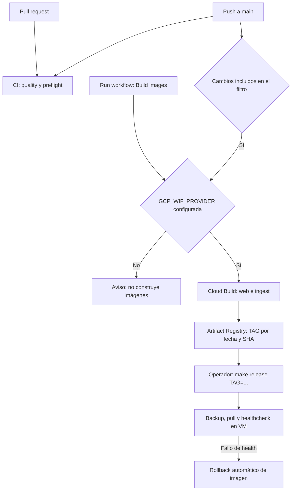

# CI/CD: validación, imágenes y despliegue

[Índice de operación](README.md) · [Índice general](../README.md)

El repositorio tiene integración continua y construcción automática de imágenes.
El despliegue a producción se ejecuta manualmente. Esta guía describe la configuración
versionada; no confirma que las variables, permisos o ejecuciones remotas estén activos.

## Flujo actual



CI y Build images son workflows independientes. La construcción no espera a que CI termine.

| Etapa | Disparador | Resultado y fuente |
|---|---|---|
| Quality Gate | PR y push a main | Node 24, npm ci, Prisma validate/generate, lint, typecheck, QA estática y build; [ci.yml](../../.github/workflows/ci.yml) |
| Deploy preflight | PR y push a main | Terraform 1.9.8, formato/validación, sintaxis Bash, Compose/Caddy y políticas; [preflight.sh](../../deploy/scripts/preflight.sh) |
| Build images | Push a main con rutas incluidas, o workflow_dispatch | Autenticación WIF y envío a Cloud Build; [build-images.yml](../../.github/workflows/build-images.yml) |
| Cloud Build | Invocación desde Actions o make build | Construye web e ingest, en paralelo, y publica ambas imágenes; [cloudbuild.yaml](../../deploy/cloudbuild.yaml) |
| Release | Operador desde deploy/ | Despliegue por TAG mediante IAP; [release.sh](../../deploy/scripts/release.sh) |

El filtro de build incluye código web, ingesta, Prisma, dependencias, Dockerfile y algunos
archivos de despliegue. La lista exacta está en `on.push.paths` del workflow: un cambio solo
de documentación no dispara esa construcción. El preflight no aplica infraestructura;
puede descargar proveedores e imágenes y omite las comprobaciones Docker si no está disponible.

## Configuración y autenticación

Las variables de GitHub Actions requeridas para construir son:

| Variable | Uso |
|---|---|
| GCP_PROJECT_ID | Proyecto destino |
| GCP_REGION | Región de Artifact Registry |
| GCP_WIF_PROVIDER | Proveedor de federación de identidad |
| GCP_WIF_SERVICE_ACCOUNT | Cuenta usada por Actions |

Consultar [configuración WIF y valores Terraform](../../deploy/docs/ci-wif.md).
Actions intercambia su identidad OIDC por acceso GCP, sin llaves JSON. La cuenta de CI
puede iniciar builds como la cuenta Cloud Build, subir fuentes y leer Artifact Registry.
Según el [módulo IAM](../../deploy/terraform/modules/ci/main.tf), no puede desplegar en la
VM ni cambiar infraestructura.

Si GCP_WIF_PROVIDER está vacía, un job deja un aviso y termina sin construir imágenes;
un workflow verde en ese caso no significa que exista un artefacto nuevo.

## De una ejecución al release

1. En GitHub → Actions, revisar los jobs Quality Gate y Deploy preflight del commit a desplegar.
   Como los workflows son independientes, comprobar ambos resultados antes del release.
2. Revisar Build images para ese commit, o lanzarlo con Run workflow sobre la referencia elegida.
   Comprobar que se ejecutó el job Cloud Build y no únicamente el aviso de falta de configuración.
3. Revisar los logs de Cloud Build y el resumen de Actions. El TAG tiene formato
   `AAAAMMDD-<SHA de siete caracteres>`. Las imágenes quedan en
   `<REGION>-docker.pkg.dev/<PROJECT>/sat-images/{web,ingest}:<TAG>`.
4. Verificar que existen **ambas** imágenes para ese TAG. El workflow actual, al detectar
   una imagen web existente, omite construir sin comprobar ingest; el resumen por sí solo
   no acredita que estén las dos.
5. Desde un equipo con acceso autorizado, ejecutar los siguientes comandos Bash/make.
   Para Windows consultar [compatibilidad](compatibilidad.md).

```bash
cd deploy
make current
make release TAG=<TAG-verificado>
make health
```

El [script de VM](../../deploy/vm/deploy.sh) realiza backup y cambio de versión, espera
el healthcheck y revierte la imagen si falla. Revisar también los logs y el flujo afectado.
`make rollback` permite volver al TAG anterior. Una migración incompatible puede requerir
restaurar la base: seguir el [runbook](../../deploy/docs/runbook.md).

Como alternativa a Actions, `make build` envía el working tree local a Cloud Build; puede
incluir cambios sin commit. Mantener identificados el origen y el TAG del artefacto que se libera.
Los cambios de infraestructura siguen plan → revisión → apply; los archivos de VM requieren
además sync-stack, según la [guía de GCP/Terraform](gcp-terraform.md).

## Limitaciones y mejoras propuestas

Estos puntos describen trabajo pendiente; esta documentación no cambia los workflows:

- Encadenar la construcción a CI exitoso del mismo commit. Actualmente puede publicarse
  una imagen aunque falle la validación.
- Verificar las dos imágenes cuando ya existe un TAG, y hacer visible la ausencia de
  configuración WIF cuando la construcción sea un requisito del proceso.
- Añadir E2E sobre datos aislados y comprobaciones Windows/PowerShell. CI actual corre en Ubuntu
  y los QA son principalmente comprobaciones estáticas; no sustituyen pruebas de flujos reales.
- Añadir un workflow de release manual con aprobación de un entorno de producción, TAG
  explícito y verificado, healthcheck y trazabilidad. Requeriría configurar una identidad
  de despliegue con los permisos correspondientes; la identidad de build actual no los tiene.

La protección de ramas, aprobaciones y estado real de variables requieren consultar GitHub;
no quedan demostrados por los archivos del repositorio.

## Recursos directos

- [Workflows y ejecuciones en GitHub](https://github.com/ribartra/sat-manager-platform/actions)
- [CI y preflight](../../.github/workflows/ci.yml)
- [Workflow de imágenes](../../.github/workflows/build-images.yml)
- [Configuración Cloud Build](../../deploy/cloudbuild.yaml)
- [Configuración WIF](../../deploy/docs/ci-wif.md)
- [Makefile de operaciones](../../deploy/Makefile)
- [Runbook de producción](../../deploy/docs/runbook.md)
- [Diagnóstico de problemas](troubleshooting.md)
